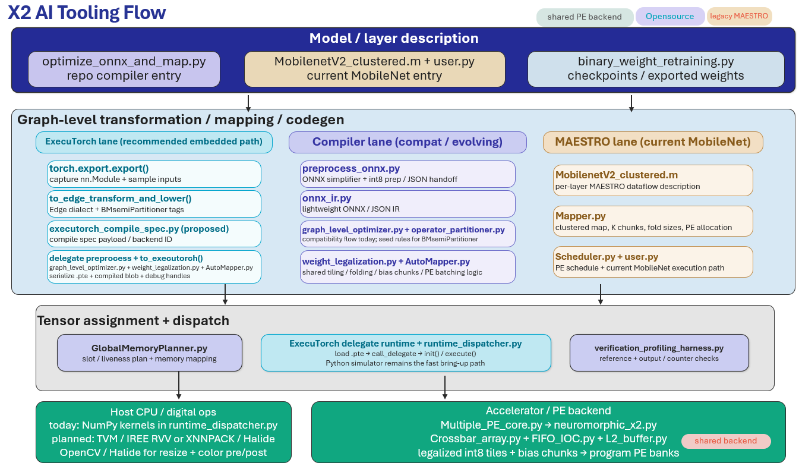

# Neuromorphic Compiler V2
# Neuromorphic Compiler V2 – X2 AI Tooling Flow


This repo is a runnable prototype of the X1 AI tooling flow shown in your
architecture sketch. It keeps the lane split you asked for:

- **ExecuTorch lane** for compile-spec generation and delegate metadata.
- **Compiler lane** for graph capture, validation, quantization, tiling, and mapping.
- **MAESTRO lane** for per-layer dataflow description generation, mapping, and scheduling.
- **Runtime lane** for memory planning, dispatch, and verification.
- **Deployment lane** for quantized deployment status and export hooks.

This version runs a **real tiny MobileNetV2-style model** on a **real image
classification task** using the `sklearn` digits dataset.

## What is integrated now

### Compiler lane

The compiler lane emits:

- `artifacts/compiler_graph.json` – main JSON graph used by this prototype.
- `artifacts/fx_graph.json` – FX graph export retained for debugging.
- `artifacts/onnx_export_status.json` – whether ONNX export succeeded.
- `artifacts/model.onnx` – only present if ONNX export succeeds in your environment.

In this runtime, `onnxscript` is not installed, so the executable path is
**JSON graph + FX-backed IR**. The ONNX step is still attempted and its status
is written to `artifacts/onnx_export_status.json`.

### MAESTRO lane

The MAESTRO lane now has a real structural integration for **per-layer
dataflow descriptions**.

Committed source references:

- `maestro/MobilenetV2_clustered.m` – committed MAESTRO-style per-layer network.
- `maestro/layer_dataflow_reference.json` – committed JSON reference for the same layers.

Generated run artifacts:

- `artifacts/maestro_layer_dataflow.json`
- `artifacts/MobilenetV2_clustered_generated.m`
- `artifacts/maestro_integration_status.json`
- `artifacts/maestro_schedule.json`

At runtime the flow cross-checks that:

- one MAESTRO descriptor exists per compute layer
- descriptor dimensions are valid
- tile coverage matches each layer `K` dimension
- every mapped tile has a matching MAESTRO descriptor
- every descriptor appears in the schedule
- the generated `.m` file matches the committed repo reference
- the generated JSON matches the committed repo JSON reference

### Quantized deployment

The repo emits:

- `artifacts/tflite_export_status.json`

This runtime does **not** include a working PyTorch → TFLite conversion bridge,
so a real `.tflite` file is not generated here. The deployment hook and status
manifest are included so you can wire the final TFLite conversion into a
TensorFlow/TFLite-ready environment.

## What is real in this repo

- real `TinyMobileNetV2` model
- real `sklearn_digits` dataset
- real training and checkpoint save/load
- real sample-image inference
- real graph capture via `torch.fx`
- real weight checks
- real activation calibration
- real int8 metadata for weights and activations
- real tiling / mapping / schedule / runtime plan checks
- real MAESTRO per-layer dataflow generation and reference cross-checks
- real checkpoint report and test summary JSON files

## Quick start

Run the full flow:

```bash
python optimize_onnx_and_map.py
```

Run the test:

```bash
pytest -q
```

## Verified result in this package

Latest bundled run:

- test accuracy: **0.9028**
- schedule entries: **24**
- MAESTRO layers: **17**
- checkpoint passes: **156**
- checkpoint failures: **0**
- pytest: **1 passed**

## Generated artifacts

A successful run writes:

- `checkpoints/tiny_mobilenetv2_digits_best.pt`
- `artifacts/sample_digit.png`
- `artifacts/executorch_compile_spec.json`
- `artifacts/compiler_graph.json`
- `artifacts/fx_graph.json`
- `artifacts/onnx_export_status.json`
- `artifacts/maestro_layer_dataflow.json`
- `artifacts/MobilenetV2_clustered_generated.m`
- `artifacts/maestro_integration_status.json`
- `artifacts/maestro_schedule.json`
- `artifacts/tflite_export_status.json`
- `artifacts/checkpoint_report.json`
- `artifacts/test_run_summary.json`
- `artifacts/run_console.log`

## Repo structure

```text
Neuromorphic_compiler_V2/
├── README.md
├── REPO_FILE_STATUS.md
├── optimize_onnx_and_map.py
├── models/
│   └── tiny_mobilenet_v2.py
├── utils/
│   └── checkpoints.py
├── executorch/
│   ├── executorch_compile_spec.py
│   ├── delegate_preprocess.py
│   └── lower_to_execu_runtime.py
├── compiler/
│   ├── preprocess_onnx.py
│   ├── onnx_ir.py
│   ├── graph_level_optimizer.py
│   ├── weight_legalization.py
│   ├── weight_cluster.py
│   ├── weight_quant.py
│   ├── activation_quant.py
│   ├── op_tiler.py
│   └── mapping_assign.py
├── maestro/
│   ├── MobilenetV2_clustered.m
│   ├── layer_dataflow_reference.json
│   ├── dataflow_builder.py
│   ├── Mapper.py
│   └── Scheduler.py
├── runtime/
│   ├── global_memory_planner.py
│   ├── dispatch.py
│   └── verification_profiling_harness.py
├── deployment/
│   └── export_tflite.py
├── tests/
│   └── test_tiny_flow.py
├── checkpoints/
└── artifacts/
```

## YOLO layer-0 integration inside the existing X1 flow

A second runnable entry point is included for integrating the **YOLO first
convolution layer** into the same compiler infrastructure without disturbing the
existing TinyMobileNetV2 path.

### Added files

- `models/yolo_layer0.py`
- `run_yolo_layer0_flow.py`
- `maestro/Yolo26n.m`
- `maestro/yolo_layer0_layer_dataflow_reference.json`

### What this integration does

The YOLO integration keeps the same lane structure:

- **ExecuTorch lane** uses the real YOLO layer-0 module as the model source.
- **Compiler lane** captures the graph, legalizes weights, quantizes,
  tiles, and maps the single convolution layer.
- **MAESTRO lane** builds per-layer descriptors for the YOLO layer and uses
  `maestro/Yolo26n.m` as the committed reference mapping.
- **Runtime lane** plans memory and dispatches the scheduled one-layer flow.
- **Deployment lane** still emits TFLite export status through the existing
  deployment hook.

### Expected YOLO source assets

`run_yolo_layer0_flow.py` expects the original YOLO one-layer assets to be
available in `Benchmarking/Yolo26_INT8_mac/` by default, or in a custom folder
passed with `--yolo-source-dir`.

Required source files:

- `layer0_weights.txt`
- `bias.txt`
- `Layer0_padding.txt`
- either all three channel dumps
  `bus_R_channel_640x640.txt`, `bus_G_channel_640x640.txt`,
  `bus_B_channel_640x640.txt`
- or `bus.jpg`

### Run the YOLO layer-0 flow

```bash
python run_yolo_layer0_flow.py
```

or with an explicit source directory:

```bash
python run_yolo_layer0_flow.py --yolo-source-dir ../Yolo26_INT8_mac
```

### First-run note for the MAESTRO JSON reference

The committed file `maestro/yolo_layer0_layer_dataflow_reference.json` is
initialized as an empty placeholder so the new path can be added cleanly to the
repo. After the first successful run, you can promote the generated artifact
`artifacts/yolo_layer0_maestro_layer_dataflow.json` into that committed JSON
reference if you want exact repo-to-generated JSON cross-checking for the YOLO
path, just like the MobileNet path.
