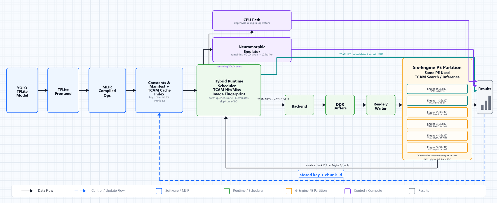

# TCAM RAG ZCU106

This folder is now the single working location for the TCAM/RAG + YOLO/MLIR
ZCU106 flow.

```text
tcam_rag_zcu106/
  run_tcam_yolo.py
  integrated/
  legacy_neuromorphic_core/
  tests/
    test_rram_int4_model.py
  scripts/
    model_rram_int4_programming_accuracy.py
    run_rram_int4_accuracy_ps.py
    probe_rram_int4_accuracy_pl.py
  rtl/
  sim/
  deploy/
  xforge_zcu106/
```

`xforge_zcu106/` is copied into this folder so the runner no longer needs the
separate sibling compiler/model path.

## Upstream Sync

The TCAM integrated Python modules in `integrated/` match:

```text
BMsemi/Neuromorphic_X1@kanna
TCAM_Search_FPGA/zcu106_tcam_rag_flow/python/tcam_rag/integrated
```

The standalone TCAM runner and the public Vision Agent API now use the same
six-engine product contract: TCAM lookup first, YOLO Layers 0/1/2/3 on FPGA
during a miss, remaining Conv2D on emulator/software, and digital ops on CPU.

## Current Flow



```text
Input image
  -> image fingerprint
  -> Constants & Manifest + TCAM Cache Index
  -> Hybrid Runtime Scheduler + TCAM Hit/Miss
       -> TCAM HIT:
            Engine 0/1 search TCAM
            return chunk_id
            fetch cached detections
            skip YOLO/MLIR
       -> TCAM MISS:
            run YOLO/MLIR
            op_0002_conv2d / logical Layer 0 -> output-channel tiles on Engine 2/3/4/5
            op_0006_conv2d / logical Layer 1 -> output-channel tiles on Engine 2/3/4/5
            op_0009_conv2d / logical Layer 2 -> output-channel tiles on Engine 2/3/4/5
            op_0013_conv2d / logical Layer 3 -> output-channel tiles on Engine 2/3/4/5
            remaining Conv2D layers -> legacy neuromorphic emulator
            depthwise/digital ops -> CPU
            store detections in chunk file
            store visual_key -> chunk_id in TCAM/cache index
```

The TCAM array is mapped onto the same PE fabric family:

```text
Engine 0: 32x32 TCAM slots 0-15, TDC enabled
Engine 1: 32x32 TCAM slots 16-31, TDC enabled
Engine 2: YOLO output-channel tile engine on miss, TDC disabled
Engine 3: YOLO output-channel tile engine on miss, TDC disabled
Engine 4: YOLO output-channel tile engine on miss, TDC disabled
Engine 5: YOLO output-channel tile engine on miss, TDC disabled
```

The first four FPGA Conv2D layers use this spatial/temporal channel policy:

```text
channel_tile_size = 16 output channels
engines = [2, 3, 4, 5]
engine = engines[tile_id mod 4]
time_step = floor(tile_id / 4)
merge = write each tile to output[:, :, :, oc_start:oc_end] in DDR/L2
barrier = next layer starts after the full tensor is merged
```

Example for a 144-output-channel layer:

```text
time_step 0:
  Engine 2 -> channels 0-15
  Engine 3 -> channels 16-31
  Engine 4 -> channels 32-47
  Engine 5 -> channels 48-63

time_step 1:
  Engine 2 -> channels 64-79
  Engine 3 -> channels 80-95
  Engine 4 -> channels 96-111
  Engine 5 -> channels 112-127

time_step 2:
  Engine 2 -> channels 128-143
```

The generated channel schedule manifest is:

```text
.\xforge_zcu106\x2_zcu106\compiler_artifacts\yolo26n_hybrid_calibrated\channel_temporal_manifest.json
```

TCAM encoding uses:

```text
q/qbar rows
A/B complementary columns
B - A differential match score
TDC-equivalent digital code
```

## Important Local Paths

```text
Model:
  .\xforge_zcu106\model\yolo26n_int8.tflite

MLIR/compiler artifacts:
  .\xforge_zcu106\x2_zcu106\compiler_artifacts\yolo26n_hybrid_calibrated

Preferred local overlay:
  .\deploy\tcam_yolo_shared_pe\overlay\zcu106_axi_x2_mvm.bit

Fallback XForge overlay:
  .\xforge_zcu106\x2_zcu106\deploy\zcu106_axi_x2_mvm.bit

Persistent cache:
  .\rag_cache
```

## Run Software Functional Test

Use this on Windows to verify first-run miss and second-run hit behavior.

```powershell
cd "C:\Users\elesamj\OneDrive - National University of Singapore\Documents\FPGA_acceleration\tcam_rag_zcu106"

& "C:\Users\elesamj\OneDrive - National University of Singapore\Documents\FPGA_acceleration\x2_sdk\releases\customer_demo\.venv\Scripts\python.exe" `
  .\run_tcam_yolo.py .\deploy\tcam_yolo_shared_pe\bus.jpg `
  --mode software `
  --cache-dir .\rag_cache `
  --output-dir .\integrated_output
```

Run the same command again. The first launch should be `tcam_miss_then_yolo`;
the second launch should be `tcam_cache_hit` and should skip YOLO.

## Model INT4 RRAM Programming Accuracy

Use this script to model 4-bit RRAM weight programming accuracy from the
diagnostic `Accuracy_INT4.jpeg` preparation-pulse heatmap:

```powershell
python .\scripts\model_rram_int4_programming_accuracy.py `
  --trials-per-code 1000 `
  --sample-records 0
```

The script maps INT4 codes to 16 conductance targets from 5 uS to 95 uS,
then runs a verify-and-pulse model using the measured SET and RESET mean
`delta_G` bins:

```text
SET delta_G   = G_after - G_before
RESET delta_G = G_before - G_after
Correct code  = final read conductance decodes to the requested INT4 level
```

Default diagnostic result from 16,000 Monte Carlo trials:

```text
overall modeled INT4 accuracy: 81.275%
mean verify pulses per cell: 2.665
max pulses used: 8

codes 0-13: mostly 87.8% to 92.3%
code 14: 36.3%
code 15: 5.2%
```

The high-code weakness comes from the source heatmap: the SET data near the
highest conductance region is sparse and includes a negative mean movement
around the 80-100 uS bin. That means this diagnostic data supports low/mid
INT4 conductance targets better than the top two codes unless more SET
characterization or a narrower target range is used.

The RRAM accuracy model now exists in both PS and PL form:

```text
PS stochastic model:
  scripts/model_rram_int4_programming_accuracy.py
  scripts/run_rram_int4_accuracy_ps.py

PL deterministic LUT model:
  rtl/rram_int4_programming_accuracy_lut.sv
  rtl/axi_rram_int4_accuracy.sv
  rtl/axi_rram_int4_accuracy_bd.v
  xforge_zcu106/x2_zcu106/rtl/rram_int4_programming_accuracy_lut.sv
  xforge_zcu106/x2_zcu106/rtl/axi_rram_int4_accuracy.sv
  xforge_zcu106/x2_zcu106/rtl/axi_rram_int4_accuracy_bd.v
```

When the PL block is rebuilt into the bitstream, the PS can probe it at
`0xA0060000`:

```bash
sudo python3 scripts/probe_rram_int4_accuracy_pl.py \
  --target-code 10 \
  --initial-g-tenth-us 500
```

## Verified ZCU106 Result

Verified after the spatial/temporal channel-tiling upgrade on the ZCU106
through USB-JTAG programming plus board-side Linux execution on 2026-09-04:

```text
FPGA program: PASS
Six-engine PE smoke: PASS
Engine bases: 0xA0000000, 0xA0010000, 0xA0020000, 0xA0030000, 0xA0040000, 0xA0050000

First bus.jpg run:
  path: tcam_miss_then_yolo
  visual_key: 0x36C8
  TCAM/cache slot: 0
  chunk_id: 1
  YOLO skipped: false
  detections: 5 total, 4 person + 1 bus
  backend counts:
    fpga_channel_tiled_layer_0: 1
    fpga_channel_tiled_layer_1: 1
    fpga_channel_tiled_layer_2: 1
    fpga_channel_tiled_layer_3: 1
    neuromorphic_emulator: 90
    cpu_depthwise: 8
    cpu_digital: 311
  channel tile records: 6
  Layer 0 op_0002: Engine 2, channels 0-15, time_step 0
  Layer 1 op_0006: Engine 2 channels 0-15 + Engine 3 channels 16-31, time_step 0
  Layer 2 op_0009: Engine 2 channels 0-15 + Engine 3 channels 16-31, time_step 0
  Layer 3 op_0013: Engine 2 channels 0-7, time_step 0
  embeddings stored:
    layer_0_op_2_channel_tiled.npy/json, shape [102400, 16]
    layer_1_op_6_channel_tiled.npy/json, shape [25600, 32]
    layer_2_op_9_channel_tiled.npy/json, shape [25600, 32]
    layer_3_op_13_channel_tiled.npy/json, shape [25600, 8]

Second bus.jpg run:
  path: tcam_cache_hit
  visual_key: 0x36C8
  chunk_id returned from TCAM/cache: 1
  match reason: digest_verified
  hamming_distance: 0
  TDC code: 32
  YOLO skipped: true
  cached detections returned: same 5 detections
  hardware TCAM searches: 1
  TCAM PE launches: 4
```

The second-run report still contains the cached first-run execution payload
because that payload is the value fetched by `chunk_id`. That is expected; the
top-level `path: tcam_cache_hit` and `yolo_skipped: true` fields are the proof
that YOLO/MLIR did not rerun on the second image.

For the current YOLO artifacts, the first four FPGA layers have 16, 32, 32,
and 8 output channels, so they all complete in `time_step 0`. The temporal
rule is still present in the manifest and runtime; it starts additional
time steps when a layer has more than 64 output channels for the four YOLO
tile engines.

## Run Hardware on ZCU106

The FPGA bitstream can be programmed from Windows with Vivado/JTAG, but
`--mode hardware` must run where PYNQ can see the programmable logic device.
That is normally the ZCU106 Linux/PYNQ environment.

Program the six-engine shared-PE overlay from Windows with:

```powershell
.\program_fpga.ps1
```

After Vivado/JTAG programming succeeds, this wrapper now also runs:

```powershell
python .\scripts\model_rram_int4_programming_accuracy.py `
  --trials-per-code 1000 `
  --sample-records 0
```

That adds the INT4 RRAM weight-programming accuracy diagnostic to the FPGA
programming flow. It does not change the FPGA bitstream; it reports the
expected 4-bit RRAM programming behavior from the preparation-pulse heatmap.
The wrapper also checks the programmed overlay metadata for the PL-side
`rram_int4_accuracy` block at `0xA0060000` and reports whether it is physically
present in the bitstream.

Use this only when you want to program the FPGA but skip the PS diagnostic:

```powershell
.\program_fpga.ps1 -SkipRramInt4Model
```

Use this when the run must fail unless the rebuilt bitstream contains the PL
RRAM INT4 block:

```powershell
.\program_fpga.ps1 -RequireRramInt4Pl
```

The currently verified six-engine overlay is still the TCAM/YOLO overlay. The
RRAM INT4 PL files have been added to the source/build flow, but they require a
fresh Vivado build before the PL probe at `0xA0060000` can pass.

Copy this entire `tcam_rag_zcu106` folder to the board, then run on the board:

```bash
cd tcam_rag_zcu106
python3 -m pip install -r deploy/tcam_yolo_shared_pe/requirements-board.txt
sudo -E python3 run_tcam_yolo.py deploy/tcam_yolo_shared_pe/bus.jpg \
  --mode hardware \
  --no-overlay-download \
  --cache-dir rag_cache \
  --output-dir integrated_output
```

Use `--no-overlay-download` when the FPGA was already programmed from Windows
over USB-JTAG. Omit it only when the matching six-engine `.bit/.hwh` pair is on
the board and PYNQ should program the PL itself. Run the same command again for
the TCAM-hit path.

If SSH/SCP is unavailable but USB serial is working, upload a small board
package with:

```powershell
.\scripts\serial_upload_file_zcu106.ps1 `
  -LocalPath .\build\tcam_rag_zcu106_board.tar.gz `
  -RemotePath /tmp/tcam_rag_zcu106_board.tar.gz
```

## Run Hardware From Windows Over SSH

Use this when Windows can program the bitstream over JTAG, but PYNQ hardware
execution must happen on the ZCU106 Linux side.

```powershell
cd "C:\Users\elesamj\OneDrive - National University of Singapore\Documents\FPGA_acceleration\tcam_rag_zcu106"

.\scripts\run_remote_zcu106.ps1
```

The script auto-discovers a reachable PYNQ/ZCU106 SSH target when `-BoardHost`
is not provided. It then copies this folder to `/home/xilinx/tcam_rag_zcu106`,
installs `deploy/tcam_yolo_shared_pe/requirements-board.txt`, and runs the same
image twice on the board:

```text
First run:
  TCAM miss -> Engine 2/3/4/5 run YOLO Layer 0/1/2/3 channel tiles
  remaining layers -> legacy neuromorphic emulator/CPU
  store visual_key -> chunk_id

Second run:
  TCAM hit -> return chunk_id
  skip YOLO/MLIR
```

If your board has a different login or IP, change `-BoardHost`, for example:

```powershell
.\scripts\run_remote_zcu106.ps1 -BoardHost xilinx@<board-ip>
```

To scan a wider local subnet before launching:

```powershell
.\scripts\run_remote_zcu106.ps1 -DeepScan
```

To only discover the board SSH address:

```powershell
.\scripts\find_zcu106_board.ps1 -DeepScan
```

If Windows routes `192.168.137.x` through Tailscale instead of the wired
adapter, bind SSH/SCP to the Ethernet address:

```powershell
.\scripts\find_zcu106_board.ps1 -DeepScan -BindAddress 192.168.137.137

.\scripts\run_remote_zcu106.ps1 `
  -BoardHost xilinx@192.168.137.99 `
  -BindAddress 192.168.137.137
```

For a permanent Windows route fix, run an Administrator PowerShell:

```powershell
cd "C:\Users\elesamj\OneDrive - National University of Singapore\Documents\FPGA_acceleration\tcam_rag_zcu106"
.\scripts\repair_windows_route_to_zcu106.ps1 -Apply
```

If the board uses the common PYNQ static address `192.168.2.99`, add a
secondary Windows Ethernet address on the same subnet:

```powershell
.\scripts\repair_zcu106_network.ps1 -Apply
```

To inspect the ZCU106 USB serial console from Windows:

```powershell
.\scripts\probe_zcu106_serial.ps1
```

If the serial console is available but SSH is not, repair the board-side
Ethernet/SSH setup from Windows:

```powershell
.\scripts\repair_zcu106_board_network_serial.ps1
```

This uses the ZCU106 serial console on `COM17`, assigns `192.168.137.99/24` to
`eth0`, restarts SSH, and makes the board target:

```text
xilinx@192.168.137.99
```

After the serial repair, verify that the physical Ethernet link is up:

```powershell
.\scripts\serial_exec_zcu106.ps1 -Port COM17 -Command `
  'ip -br link show eth0; cat /sys/class/net/eth0/carrier; systemctl is-active ssh'
```

Expected good state:

```text
eth0 UP ... LOWER_UP
1
active
```

If `carrier` is `0` or `eth0` shows `NO-CARRIER`, the board software is ready
but the RJ45 cable/link is not active. Use the ZCU106 Ethernet RJ45 connected
to the same Windows Ethernet network/switch, then rerun the SSH command.

To check the command construction without copying files or contacting the board:

```powershell
.\scripts\run_remote_zcu106.ps1 -BoardHost xilinx@<board-ip> -DryRun
```

## Windows Hardware Limitation

PYNQ is installed in the local YOLO virtual environment at:

```text
C:\Users\elesamj\OneDrive - National University of Singapore\Documents\FPGA_acceleration\x2_sdk\releases\customer_demo\.venv\Lib\site-packages\pynq
```

However, running hardware mode on Windows currently fails with:

```text
RuntimeError: No Devices Found
```

That means the Python process cannot see a PYNQ/XRT programmable logic device
from Windows. The consolidated folder fixes the file-layout problem, but the
hardware execution still needs to run on the ZCU106 PS/Linux side or through a
proper board-side remote runner.

## Tests

```powershell
cd "C:\Users\elesamj\OneDrive - National University of Singapore\Documents\FPGA_acceleration\tcam_rag_zcu106"
python .\tests\test_integrated.py
```

Expected:

```text
PASS
```
