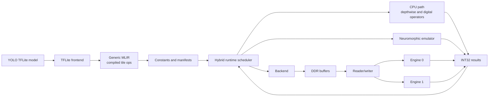

# TFLite-To-MLIR Compiler Prototype

This package implements the compiler path used by the YOLO26n demo. TFLite is
the model input format, MLIR is the compiler artifact format, and the runtime
dispatches compiled Conv2D layers to the neuromorphic emulator or backend path.

## Customer-Facing Architecture



Use only these simple block names in customer-facing material. Internal engine,
transport, memory, and vendor-specific names should stay out of screenshots,
READMEs, and installation instructions.

## Current Prototype

- imports real TFLite `CONV_2D` operators and INT8 weights;
- lowers each convolution to NHWC `im2col` plus signed INT8 matrix multiply;
- tiles K and N dimensions into 32x32 compiled MVM tiles;
- batches M rows into groups of at most 32;
- emits `manifest.json`, `constants.npz`, and parseable MLIR artifacts;
- executes the same artifacts through the neuromorphic emulator;
- accumulates K tiles in INT32 and applies per-channel weight scales and bias;
- partitions the full 413-operator YOLO graph across 94 accelerated Conv2D
  operators, eight CPU depthwise operators, and 311 CPU digital operators;
- performs preprocessing, class-aware NMS, annotation, trace capture, and
  optional LiteRT comparison without using reference tensors as fallbacks.

## Install

From the workspace root:

```powershell
python -m venv .venv
.\.venv\Scripts\python.exe -m pip install -r <compiler-source>\requirements.txt
```

## Compile One YOLO Layer

```powershell
python -m <compiler-package>.compile_tflite `
  --model <model-path>\yolo26n_int8.tflite `
  --op-index 2 `
  --activation-max-abs 1.0 `
  --output <artifact-directory>\yolo26n_first_conv
```

## Run One Compiled Layer

```powershell
python -m <compiler-package>.run_compiled_conv `
  --program <artifact-directory>\yolo26n_first_conv `
  --backend local `
  --image <image-path>\bus.jpg `
  --output C:\compiler_build\compiled_bus_run
```

## Run The Complete YOLO Graph

```powershell
python -m <compiler-package>.run_hybrid_yolo `
  <model-path>\yolo26n_int8.tflite `
  <artifact-directory>\yolo26n_hybrid_calibrated `
  <image-path>\bus.jpg `
  --backend local --offload all --validate-reference `
  --output-dir <output-path>\mlir_local_final
```

## Latest Local Smoke Result

- operators: 413
- accelerated Conv2D layers: 94
- detections: 5
- matched reference detections: 5/5
- mean IoU: 0.9656
- cosine similarity: 0.99972
- accelerator calls: 99,168
- logical MACs: 2.665 GMAC

## Tests

```powershell
python -m <compiler-package>.test_compiler

python -m <compiler-package>.validate_tflite_layer `
  --model <model-path>\yolo26n_int8.tflite `
  --program <artifact-directory>\yolo26n_first_conv `
  --output <artifact-directory>\yolo26n_first_conv\validation.json
```
