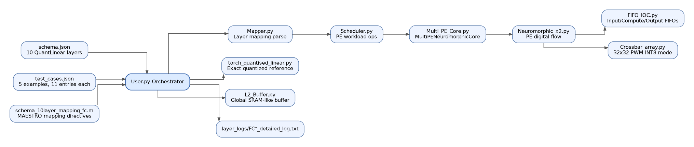
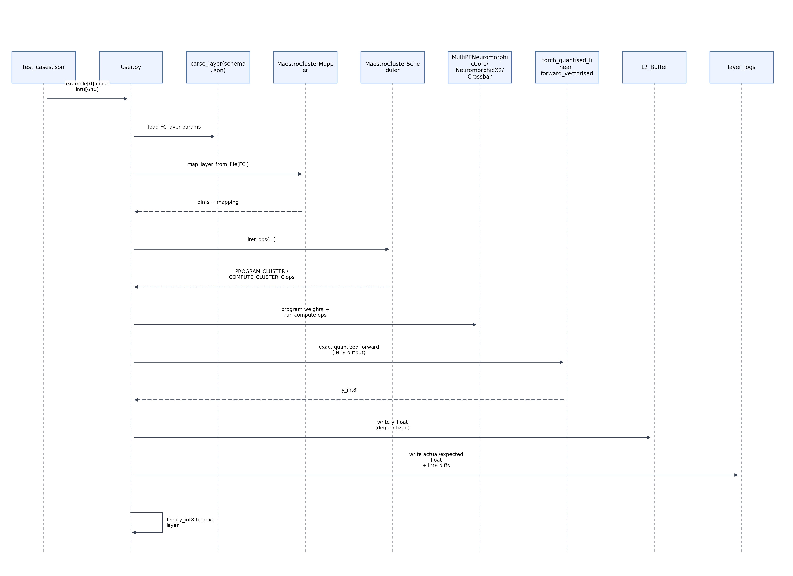
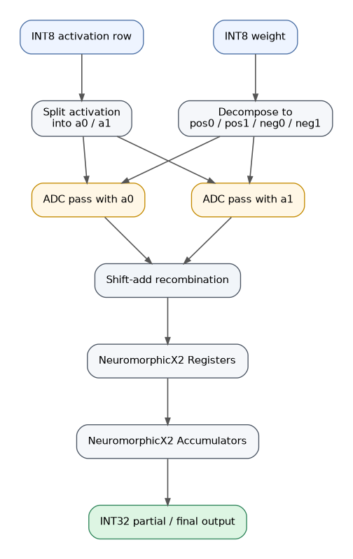

# DeepGate INT8 Compiler and Neuromorphic Simulator

This repository contains an end-to-end INT8 inference flow for the AD01 anomaly-detection autoencoder, including:

- Mapping and scheduling from MAESTRO-style `.m` directives
- Crossbar-aware execution on a simulated multi-PE neuromorphic architecture
- Exact quantized reference math for layer outputs
- Layer-wise validation and detailed logs
# About the model used
- ADO1 model is a fully connected auto encoder trained on 640-dim MFCC audio features.
- It reconstructs normal sounds and flags anomalies via reconstruction error.
- It uses 10 Quantlinear layers with a 8 unit bottleneck and 640 unit reconstruction output.
- FC0 expects quantized INT8 hence there are no CONV/POOLING/RESIDUAL layers.
- Inference is integer only with INT8 activations between layers.

The main orchestrator is `User.py`, which connects all compiler and simulator modules.

## 1. System Overview



## 2. What `User.py` Does

`User.py` is the integration layer for the full compiler and simulator stack.

It:

- Loads model parameters from `schema.json`
- Loads validation vectors from `test_cases.json`
- Parses per-layer mapping from `schema_10layer_mapping_fc.m`
- Builds scheduler ops and programs or computes on multi-PE hardware simulation
- Computes exact INT8 outputs through `torch_quantised_linear_forward_vectorised`
- Stores dequantized outputs in `L2_Buffer`
- Compares results against expected outputs from test cases
- Writes per-layer detailed logs under `layer_logs/`

Important architectural point:

- The hardware path is used for mapping, programming, PE activity, and utilization simulation.
- The final correctness path is the quantized math in `torch_quantised_linear.py`.

## 3. Data and Model Artifacts

### `schema.json`

- Top-level is an array of 10 layer specs, from FC0 to FC9.
- Contains `weights_int8`, `bias_int32`, `input_zp`, `output_zp`, `requant_multiplier`, `requant_shift`, `output_scale`, and `act_func`.

Layer activation profile:

- FC0-FC8: `act_func = relu`, `output_zp = -128`
- FC9: `act_func = null`, `output_zp = -40`

### `test_cases.json`

- `examples = 5`
- Each example has `11` entries:
  - Entry 0: input (`layer = "input"`, `dtype = "int8"`, shape `[640]`)
  - Entries 1-10: per-layer expected outputs (`dtype = "float32"`)

Note:

- The final 640-element output in `test_cases.json` is float32 reference.
- The runtime INT8 final output is logged as `actual_int8` in `layer_logs/FC9_detailed_log.txt`.

### `schema_10layer_mapping_fc.m`

- MAESTRO-style directives for FC0 to FC9
- Uses:
  - `SpatialMap(8,8) K`
  - `TemporalMap(32,32) C`
  - `TemporalMap(1,1)` for `Y/X/R/S`

## 4. Compiler and Runtime Flow



## 5. Module-by-Module Responsibilities

### `User.py`

Top-level compiler driver and validator. It loads data, maps and schedules layers, triggers PE simulation, computes exact INT8 results, and emits logs.

### `Mapper.py`

Parses MAESTRO directives such as `Stride`, `Dimensions`, and `Dataflow`. It derives chunking, folding, and clustered map metadata.

### `Scheduler.py`

Converts mapping results into executable operations such as `PROGRAM_CLUSTER` and `COMPUTE_CLUSTER_C`. It also enforces output-stationary compute sequencing.

### `FIFO_IOC.py`

FIFO primitive for PE internal queues.

### `L2_Buffer.py`

Global SRAM-like storage for layer outputs, with layer-level clear and eviction behavior.

### `Multi_PE_Core.py`

Multi-PE manager (`MultiPENeuromorphicCore`) over many `NeuromorphicX2` instances.

### `Neuromorphic_x2.py`

Per-PE digital flow: Input FIFO -> Compute FIFO -> Crossbar -> Registers -> Accumulators -> Output FIFO.

### `Crossbar_array.py`

32x32 crossbar model with PWM INT8 row-serial mode and legacy modes.

### `torch_quantised_linear.py`

Reference quantized kernels such as `sat_round_doubling_high_mul`, `round_shift_right`, and the vectorized forward path.

### `schema_10layer_mapping_fc.m`

Mapping directives for each FC layer.

### `schema.json`

Model weights and quantization metadata.

### `test_cases.json`

Input and expected outputs used for layer-by-layer validation.

## 6. Crossbar and PE Micro-Architecture

### Crossbar mode used by this flow

`Crossbar_array.py` supports `PWM_INT8_ROW_SERIAL`:

- Physical crossbar: `32 x 32`
- INT8 weights are decomposed into 4-bit banks:
  - `w_pos0`, `w_pos1`, `w_neg0`, `w_neg1`
- Differential representation:
  - positive and negative paths are separated by bank
- Activation split:
  - `a = a0 + 16*a1` (nibble-wise)
- Two passes per row (`a0`, `a1`) with ADC and digital recombination



### Neuromorphic X2 PE role

- Controls per-iteration digital behavior:
  1. Latch partial MAC into registers
  2. Accumulate across temporal iterations
- Uses FIFO stages for data movement.

## 7. Mapping and Scheduling Notes

### Terms

- `K`: output channels (neurons)
- `C`: input channels
- `R`, `S`: filter height and width. For FC layers here both are `1`.
- `Y`, `X`: feature-map dimensions. For FC layers here both are `1`.

### Mapper behavior

- Parses each layer block and computes:
  - `k_chunks`
  - `fold_sizes` from `C*R*S` with a 32-row limit
  - loop metadata
- Cluster directive is supported in code.
- For unclustered FC mappings, the clustered mapper provides fallback metadata so the scheduler flow stays unified.

### Scheduler behavior

- Emits explicit program and compute operations.
- The current clustered scheduler path uses output-stationary loop ordering, documented in code as `YXKC` for emitted compute ops.

### Latency objective

`LatencyObjective.py` defines the deterministic per-layer objective used by `User.py`:

```text
Static weights:
minimize J_static = L_program_once + L_compute + L_finalize

loop order = K -> C -> (RSYX when R,S > 1, otherwise YXRS)

L_program_once = ceil(active_program_lanes / program_ports) * program_tile_cycles

L_compute = output_positions * k_waves * c_waves *
            sum_over_C_folds(input_buffer_read
                             + fold_size * pwm_pass_cycles_per_row
                             + digital_accumulate)

L_finalize = output_positions * k_waves *
             (reduction_tree + output_buffer_write + requant + activation)

Dynamic weights:
minimize J_dynamic = output_positions * k_waves * c_waves *
                     sum_over_C_folds(program_fold + compute_fold)
                     + L_finalize
```

For FC layers, the legal mapping keeps `SpatialMap(8,8) K` because one PE computes up
to 8 output neurons. K is the outer loop, C is next, and YXRS is used for the unit FC
loops; RSYX is selected when both R and S are greater than 1. C is folded over 32-row
crossbar chunks. `Cluster(...)` is reserved for cases that genuinely need clustered PE
allocation, such as larger R/S convolutional mappings. When `DYNAMIC_WEIGHT_REPROGRAMMING
= True`, each C fold includes program latency before inference. K groups in the same
spatial wave execute in parallel, so the C-fold latency is multiplied by `k_waves`, not
by every K group.

## 8. Quantized Math Path (Reference Correctness)

`torch_quantised_linear.py` provides the deterministic INT8 path:

1. Dot product plus `bias_int32`
2. `sat_round_doubling_high_mul`
3. `round_shift_right`
4. Add `output_zeropoint`
5. Clamp to dtype range and cast

This path is what `User.py` uses for the final `y_int8` of each layer.

## 9. Logging and Validation

When `GENERATE_LAYER_LOGS = True` in `User.py`, each layer gets:

- `layer_logs/FC0_detailed_log.txt` through `layer_logs/FC9_detailed_log.txt`

Each log includes:

- `actual_float` vs `expected_float`
- `actual_int8` vs `expected_int8_from_expected_float`
- `int8_diff` and mismatch indices
- Per-layer summary metrics such as `avg_max_err` and `worst_max_q_err`

## 10. Running the Pipeline

From repository root:

```powershell
python User.py
```

Outputs:

- Console summary, including per test-case pass or fail, PE utilization, and L2 stats
- Layer logs under `layer_logs/`

## 11. Practical Interpretation

This repository behaves as an INT8 model compiler and simulator:

- Compiler side: map and schedule directives plus tile-level orchestration
- Simulator side: crossbar and PE execution modeling
- Accuracy side: exact quantized reference path for ground-truth layer outputs

This combination lets you debug hardware-aware scheduling while still validating against deterministic INT8 math.

## Getting Started with the App

To get the application running on your local machine, please follow the detailed environment configuration and launch steps in our setup guide:

**[Local Setup Instructions (appsetup.md)](./APPSETUP.md)**
