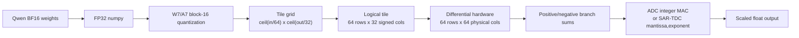

# FP4LLM ReRAM Reliability and Noise Modeling

This folder evaluates FP4LLM's ReRAM crossbar path for Qwen3-1.7B. It covers
crossbar mapping, W7/A7 execution, ADC clipping, persistent reliability faults,
read noise, and dynamic K/V cache programming cost.

The lm-eval runs in this repo are deterministic hardware-sensitivity probes.
They use a real `Qwen/Qwen3-1.7B` safetensor projection slice, but they are not
full public benchmark scores.

## Qwen frontend: noise-on versus clean inference

`qwen_frontend.py` runs matched full-model comparisons with read noise and
reliability affecting the forward outputs. Use `--plan "all:crossbar"` with
`--crossbar-config configs/qwen_crossbar_noise.json`; this maps all linear
projections, the LM head, and attention QK/AV products to the software crossbar
path. The clean arm disables both noise and reliability with matching
quantization. See [the comparison guide](docs/qwen_frontend_noise.md) for model
paths, execution assumptions, output metrics, and the Windows launcher.

## Quick Facts

| Item | Value |
|---|---:|
| Model | `Qwen/Qwen3-1.7B`, dense, 28 transformer blocks |
| Mapping files | `mappings/Qwen3_1_7B_prefill.m`, `mappings/Qwen3_1_7B_decode.m` |
| Crossbar tile | 64 input rows x 32 signed logical columns |
| Physical columns | 64 differential positive/negative columns |
| Quantization | W7/A7, block-16 |
| Execution path | BF16-default tensor boundary -> block W/A quantization -> INT8 PWM codes -> differential crossbar -> ADC or SAR-TDC output |
| Main executor files | `llm_reram_executor.py`, `reram_crossbar.py`, `src/crossbar_wrapper.py` |
| Mapping optimizer | `llm_mapping_optimizer.py` |
| Post-inference report | `post_inference_report.py` |
| Full-model entry point / runtime | `main.py`, `src/qwen_crossbar_runtime.py` |

## Full-Model Prompt Run

For **new prompts using FPGA block 0 followed by Python blocks 1–27**, use
the project-root `run_qwen_fpga_continuation.py` and follow
[the multi-token prefill guide](docs/fpga_python_new_prompts.md).
The runner archived under `results/qwen_model_execution_x2/` remains specific to the original Hello experiment.

For the new **ZCU106 four-LPC/two-NLPC block-1 prefill mode**, see
[the FPGA setup and execution guide](docs/fpga_block1_prefill_six_engines.md).
Use `--execution-target fpga6` with the Qwen6 overlay and exported weight/input
bundle. This mode uses PS-side BF16→INT8 conversion and FPGA block arithmetic.
Physical-board validation is tracked separately in
[the validation record](fpga/qwen6/validation.md).

`main.py` optimizes the mappings and directly calls the reusable Qwen runtime.
By default, all 28 blocks use `CrossbarLinear` -> `ReRAMLinearExecutor` ->
`reram_crossbar.py:CrossbarArray.compute` for the seven projections per block
and both attention GEMMs (QK^T and AV). The old block-1 experiment file is no
longer required.

```bash
python -B main.py \
  --prompt "Explain how ReRAM crossbars perform matrix multiplication." \
  --decode-text " next" \
  --local-root D:/hf_models \
  --local-files-only \
  --max-candidates 1
```

The defaults are `--crossbar-backend wrapper --crossbar-execution block_streamed`,
with outputs under `results/x1_reram_run`. Main orchestrates all blocks automatically:
compact quantized projection weights stay in CPU RAM; a block's crossbar tiles are
programmed immediately before its forward call and released immediately afterwards,
including on failure. Prefill and decode both follow this lifecycle, using the same
`CrossbarArray.compute` path, quantization scales, tile geometry, and accumulation order
as eager execution. No crossbar math or precision is changed.

The block output remains a framework activation tensor and feeds the next block.
The KV cache persists across blocks and decode calls. Diagnostic activation captures
remain on CPU and are exported to `software_crossbar/<run-name>_bf16_values.txt`.
This represents buffer contents, not a finite-capacity FIFO, DMA, or L2 timing model.
Only one block's projection tiles are resident, but all compact weights, framework
weights, KV caches, and captures still require memory. Rebuilding tiles adds host runtime;
it is simulation memory management, not additional physical writes in the endurance model.

`software_crossbar/metadata.json` and `main_summary.json` report `crossbar_execution`
and `crossbar_tile_lifecycle`, including the peak resident block count and program/release
events. Use `--crossbar-execution eager` to retain all tiles for comparison on a machine
with sufficient memory. Tile release requires forward noise, reliability, IV, and TDC
to be disabled, as they already are in this workflow; the separate audits are unchanged.

Use `--block-index N` for a single block or `--crossbar-backend ideal_int` for
the faster integer-matmul reference. The detailed tile simulation can require
substantially more memory and time than the reference backend. The existing
`results/x1_full_model_run` artifacts are from the earlier `ideal_int` run,
not a full-checkpoint ReRAM-wrapper validation.

This workflow runs prefill followed by one supplied decode token, not a free-running
generation loop. Embedding, normalization, RoPE, softmax, elementwise operations,
and the LM head remain framework operations. The forward computation uses ideal
device settings in the detailed ReRAM simulator; noise, reliability, IV saturation,
and TDC are measured in separate audits and do not alter the forward outputs.

Run the tiny-checkpoint regression suite with `python -B -m unittest test_prompt_crossbar -v`.

## Post-Inference GPU/Crossbar/Endurance Report

After an inference run, use `post_inference_report.py` to tie together the
same-token reference run, the actual crossbar summary, the Qwen mapping files,
and the endurance report.

The report uses the mapping files in `mappings/` as the source of truth for the
crossbar path:

```text
mappings/Qwen3_1_7B_prefill.m
mappings/Qwen3_1_7B_decode.m
```

Example local smoke run:

```bash
python llm_reram_executor.py \
  --seq-len 4 \
  --d-model 16 \
  --heads 2 \
  --d-ff 32 \
  --layers 1 \
  --vocab-size 64 \
  --disable-noise \
  --disable-iv-nonlinearity \
  --summary results/post_inference_report/crossbar_smoke_summary.json

python post_inference_report.py \
  --crossbar-summary results/post_inference_report/crossbar_smoke_summary.json \
  --out-dir results/post_inference_report
```

On a CUDA machine, the same report command runs the dense reference on GPU by
default. Use `--require-gpu` when the run must fail instead of falling back to a
CPU dense reference:

```bash
python post_inference_report.py \
  --crossbar-summary results/post_inference_report/crossbar_smoke_summary.json \
  --out-dir results/post_inference_report \
  --require-gpu
```

Generated artifacts:

| Artifact | Purpose |
|---|---|
| `results/post_inference_report/post_inference_report.md` | Human-readable GPU/reference vs crossbar, endurance, and support summary |
| `results/post_inference_report/post_inference_report.json` | Machine-readable full report |
| `results/post_inference_report/endurance_report.csv` | Static-weight, dynamic K/V, and dynamic attention endurance rows |
| `results/post_inference_report/mapping_support.csv` | Role-by-role PE/crossbar support from the mapping files |
| `results/post_inference_report/model_support.csv` | Model-family support status for the current repo |

Latest post-inference smoke result:

| Item | Result |
|---|---:|
| Reference/crossbar tokens | 4 |
| Dense reference backend | `torch_cpu_dense_reference` because local CUDA was unavailable |
| Sampled-token match fraction | 1.0 |
| Final-logits checksum delta | 0.0016188621520996094 |
| Static weight endurance margin | 100000.0 |
| Dynamic K/V endurance margin | 285.7432775240995 |

## Historical One-Block Software Crossbar Hardware-Effects Run

This is the latest prompt-aware one-transformer-block software crossbar run. The
GPU reference folder is kept only as the source of the exact prompt, prefill
tokens, and decode token. No GPU-vs-crossbar comparison was rerun for this
section.

Reference stimulus source:

```text
results/Qwen3-1.7B_Transformer_block_1_20260616_124549/
```

Software crossbar output:

```text
results/qwen3_block1_hwfx_20260623/
```

The run emits the normal BF16 tensor dump plus a dedicated hardware-effects
audit for reliability, read noise, IV/ADC saturation, and SAR-TDC readout:

| Artifact | Purpose |
|---|---|
| `qwen3_block1_hwfx_20260623_bf16_values.txt` | Per-value BF16 hex and float32-readable values for the mapped software crossbar run |
| `qwen3_block1_hwfx_20260623_summary.txt` | Per-tensor shape/stat summary |
| `metadata.json` | Input IDs, model path, mapping files, mapped block layers, crossbar backend, quantization settings, timing, saturation summary, and hardware-effect summary |
| `mapped_block_layers.csv` | The selected block-1 entries from the prefill/decode MAESTRO mapping files |
| `mapping_validation.csv` | Actual token/context sizes checked against mapped capacities |
| `hardware_effects_report.md` / `.json` / `.csv` | Reliability, read-noise, IV/ADC, and TDC errors measured on the real prefill/decode tensors |
| `saturation_report.md` / `.json` / `.csv` | Standalone IV/ADC full-scale saturation events and clamped tile-column counts |
| `endurance_report.md` / `.json` / `.csv` | Static-linears and dynamic K/V endurance report |

Equivalent command using the relocated runtime (the results below are historical):

```bash
python -m src.qwen_crossbar_runtime \
  --run-name qwen3_block1_hwfx_20260623 \
  --out-dir results/qwen3_block1_hwfx_20260623 \
  --gpu-metadata results/Qwen3-1.7B_Transformer_block_1_20260616_124549/metadata.json \
  --prefill-mapping mappings/Qwen3_1_7B_prefill.m \
  --decode-mapping mappings/Qwen3_1_7B_decode.m \
  --local-root E:/hf_models \
  --local-files-only \
  --dtype bfloat16 \
  --device cpu \
  --crossbar-backend ideal_int \
  --weight-bits 7 \
  --act-bits 7 \
  --enable-saturation-audit \
  --enable-hardware-effects-audit \
  --saturation-row-groups 4 \
  --iv-linear-rows-before-clamp 10 \
  --tdc-precision-mode 9b \
  --tdc-output-format sar_fp \
  --reliability-retention-days 30 \
  --reliability-raw-ber-ppm 10 \
  --reliability-state-sigma-ln 0.02 \
  --noise-bandwidth-hz 5000
```

Prompt / input stimulus:

| Item | Value |
|---|---|
| Reference artifact | `results/Qwen3-1.7B_Transformer_block_1_20260616_124549/metadata.json` |
| Reference script | `Experiments/qwen3_transformer_block1_gpu_reference.py` |
| Model | `Qwen/Qwen3-1.7B` |
| Transformer block | Block index 0 / transformer block 1 |
| Reference prompt | `"GPU reference for Qwen3-1.7B transformer block one. Capture prefill and decode outputs for later crossbar verification."` |
| Prefill input shape | `[1, 27]` |
| Prefill input IDs | `[49891, 5785, 369, 1207, 16948, 18, 12, 16, 13, 22, 33, 42578, 2504, 825, 13, 39885, 855, 7559, 323, 16895, 16275, 369, 2937, 5312, 2257, 22901, 13]` |
| Reference decode text | `" next"` |
| Decode input shape | `[1, 1]` |
| Decode input IDs | `[1790]` |
| Software crossbar timing | prefill 14.8231 s, decode 1.2196 s |

Mapping validation:

| Check | Actual | Mapped capacity |
|---|---:|---:|
| Prefill linear/attention tokens | 27 | 512 |
| Decode linear tokens | 1 | 1 |
| Prefill attention context | 27 | 512 |
| Decode attention context | 28 | 513 |

The 512/513 values in the `.m` files are treated as maximum mapped capacity for
this run, so the existing GPU reference sequence fits without editing the
mapping files. The older synthetic decode-only rerun has been removed from this
README and from `results/`.

Latest mapped one-block workload:

| Phase | Mapped roles | Actual prompt/query tokens | Context used by attention | Mapped crossbar tiles | MACs |
|---|---:|---:|---:|---:|---:|
| Prefill | 8 | 27 | 27 | 18,496 | 1,361,940,480 |
| Decode | 8 | 1 | 28 | 18,502 | 50,446,336 |

Hardware-effect errors observed during the software-crossbar inference:

| Effect | Enabled hardware model | Main measured error / stress |
|---|---|---|
| Reliability | 30-day retention drift, 0.02 log-normal state spread, 10 ppm raw BER with ECC | 404,152,320 programmed cell reads audited; 402,509,700 cell levels changed after the retention model; 2 raw BER flips after ECC; 16,831,854 effective INT8 weight entries changed; mean absolute integer branch error 5.140567; max 1,217 |
| Noise | Thermal `4 k T / R`, shot `2 q I * fano`, flicker/1/f, RTN, readout RMS, 5 kHz bandwidth integration | Mean equivalent branch read-noise sigma 28.503848 conductance levels; max 32.351608 levels |
| IV / ADC | `hard_clamp`, 4 row groups, full-scale 2,250 product levels before digitization | 22,766 upper saturation events; 0 lower clips; 6,680 clamped tile-columns; 2,745 saturated tiles; max branch level 37,467 |
| TDC | 9-bit signed-payload SAR-FP TDC, `gain_shift=0` | 22,101,664 output values converted; 198,914,976 wire bits; 0 extra SAR range clips after IV limiting; mean absolute integer readout error 6.663875; max 58,444 |

Hardware-effect errors by phase:

| Phase | Reliability mean / max int error | Noise mean / max sigma | IV saturation events | Clamped tile-columns | TDC mean / max int error |
|---|---:|---:|---:|---:|---:|
| Prefill | 4.983432 / 1,217 | 28.504046 / 31.214855 | 19,411 | 3,463 | 6.390476 / 38,893 |
| Decode | 9.383060 / 513 | 28.498481 / 32.351608 | 3,355 | 3,217 | 14.045362 / 58,444 |
| **Total** | **5.140567 / 1,217** | **28.503848 / 32.351608** | **22,766** | **6,680** | **6.663875 / 58,444** |

Largest observed hardware-error hotspots:

| Phase | Role | Module / GEMM | IV saturation events | Clamped tile-columns | Reliability mean int error | TDC mean / max int error |
|---|---|---|---:|---:|---:|---:|
| Prefill | `attn_av` | `mapped_attn_av` | 8,834 | 1,628 | 9.916780 | 257.360279 / 38,893 |
| Decode | `attn_av` | `mapped_attn_av` | 777 | 747 | 16.569458 | 805.297363 / 58,444 |
| Decode | `v_proj` | `v_proj` | 1,096 | 1,080 | 20.784958 | 43.299286 / 8,374 |
| Prefill | `ffn_up` | `gate_proj` | 5,270 | 537 | 5.740430 | 6.797378 / 10,363 |
| Prefill | `q_proj` | `q_proj` | 2,263 | 356 | 5.770995 | 7.627803 / 11,188 |

Reliability counts above are audit events over prefill plus decode reads. The
unique static transformer-block linears have 201,326,592 programmed cells; the
larger reliability audit count also includes the same static weights observed in
both phases plus mapped attention GEMM storage/readout pressure.

Latest one-block endurance result:

| Category | Status | Programmed cells | Cycles/cell | Endurance cycles | Margin |
|---|---:|---:|---:|---:|---:|
| Static transformer block linears | meets inference programming | 201,326,592 | 1 | 100,000 | 100,000.0 |
| Dynamic K/V cache for one block | below projection | 57,344 | 56,314,285.71428572 | 10,000,000 | 0.17757483510908167 |

The software crossbar backend used for this one-block run is `ideal_int`: it
applies the repo's W7/A7 block-16 quantization, signed INT MAC, scaling, and
BF16 boundary rounding for the Q/K/V/O and MLP linears. The run also uses the
MAESTRO mapping roles for QK^T attention scores and attention AV GEMMs. This is
the fast full-shape software crossbar value path. The slower `wrapper` backend
can be selected when the run must instantiate `CrossbarLinear`/`CrossbarArray`
tiles directly for the same block.

Model support rule:

| Model or family | Current repo crossbar path | Why |
|---|---:|---|
| Qwen3-1.7B | supported hybrid path | Prefill and decode mappings are present in `mappings/`; dense/attention MAC roles map to PE/crossbar tiles |
| Other Qwen3 dense sizes | mapping required | Architecture is similar, but size-correct mapping files must be generated first |
| LLaMA / Mistral / Gemma dense decoder-only | mapping required | Linear layers are PE-compatible, but repo mappings/runtime adapters are not provided for those models |
| GPT-2 style decoder-only | mapping required | Linear layers are PE-compatible, but no GPT-2 mapping is present |
| BERT / RoBERTa | not currently supported | Current path is causal decoder inference, not bidirectional encoder inference |
| T5 / encoder-decoder | not currently supported | Cross-attention and encoder-decoder scheduling are not mapped |
| MoE transformer models | not currently supported | Expert routing and expert scheduling are not implemented |

This means Qwen3-1.7B is not a pure-crossbar-only model. It is supported as a
hybrid path: PE/crossbar tiles perform MAC-heavy stages, while embedding,
RMSNorm, q/k norm, RoPE, K/V cache control, causal mask, softmax, SiLU/SwiGLU,
residual adds, and sampling remain outside the PE.

## Crossbar Flow



Weights are programmed once for static dense layers. Activations are quantized
on every forward pass. Dynamic K/V cache entries are programmed during decode.

## Transformer PE Connection Flow

```mermaid
flowchart TD
  T["token id"] --> E["Embedding SRAM lookup<br/>runtime module"]
  E --> H["hidden vector buffer<br/>runtime module"]
  H --> N1["RMSNorm<br/>runtime module"]
  N1 --> QKV["Q/K/V projection<br/>PE array"]
  QKV --> QKN["q_norm / k_norm<br/>runtime module"]
  QKN --> R["RoPE positional encoding<br/>runtime module"]
  R --> KV["KV-cache indexing/control<br/>runtime module"]
  KV --> S["Q x K^T attention scores<br/>PE array"]
  S --> M["causal mask<br/>runtime module"]
  M --> SM["softmax<br/>runtime module"]
  SM --> AV["softmax x V<br/>PE array"]
  AV --> O["output projection<br/>PE array"]
  O --> RA1["residual add<br/>runtime module"]
  RA1 --> N2["RMSNorm<br/>runtime module"]
  N2 --> GU["gate/up projection<br/>PE array"]
  GU --> SILU["SiLU activation<br/>runtime module"]
  SILU --> SWI["SwiGLU multiply<br/>runtime module"]
  SWI --> D["down projection<br/>PE array"]
  D --> RA2["residual add<br/>runtime module"]
  RA2 --> L["final logits / LM head<br/>PE array"]
  L --> SAMPLE["argmax / top-k / top-p sampling<br/>runtime module"]

  classDef pe fill:#dbeafe,stroke:#1d4ed8,color:#111827;
  classDef module fill:#ecfdf5,stroke:#047857,color:#111827;
  class QKV,S,AV,O,GU,D,L pe;
  class E,H,N1,QKN,R,KV,M,SM,RA1,N2,SILU,SWI,RA2,SAMPLE module;
```



The PE array is only used for matrix/vector MAC stages: Q/K/V projection,
attention score, attention value, output projection, FFN gate/up/down, and the
LM head. The surrounding transformer operations are implemented as separate
runtime modules in `transformer_runtime_modules.py` and are called from
`run_transformer_demo()` and `run_transformer_decode_demo()` during inference.

| Runtime module | Not inside PE | Called for |
|---|---:|---|
| `EmbeddingLookupModule` | yes | token id to embedding SRAM read |
| `HiddenVectorBufferModule` | yes | staging hidden vectors between stages |
| `RMSNormModule` | yes | pre-attention and pre-FFN normalization |
| `QKNormModule` | yes | separate query/key head normalization |
| `RoPEModule` | yes | positional rotation on Q and K |
| `KVCacheControlModule` | yes | token-slot K/V append and read control |
| `CausalMaskModule` | yes | masking future positions before softmax |
| `SoftmaxModule` | yes | attention probability normalization |
| `SiLUModule` | yes | gate activation |
| `SwiGLUMultiplyModule` | yes | `silu(gate) * up` |
| `ResidualAddModule` | yes | attention and FFN skip adds |
| `TokenSamplingModule` | yes | argmax, top-k, and top-p token choice |
| `BF16ArithmeticModule` | yes | direct BF16 rounding at non-PE boundaries |

Each run summary now includes `non_pe_module_catalog`,
`non_pe_module_execution`, `input_token_ids`, `sampled_token_ids`, and
`final_logits_shape` so the execution order can be inspected after inference.

## Inference Run: Prefill And Decode

An inference run has two connected phases. Prefill consumes the full prompt and
builds the K/V cache. Decode then consumes one generated token at a time, reuses
the cache from prefill, appends the new token's K/V, and samples the next token.

```text
prompt tokens
  -> prefill
  -> K/V cache contains prompt memory
  -> logits for the last prompt position
  -> sample first generated token
  -> decode token by token
  -> append one K/V entry per generated token
  -> sample the next token each step
```

### Prefill Procedure

Prefill is the batch phase for the input prompt. If the prompt has `T` tokens,
the embedding and transformer layers operate on all `T` prompt positions.

```text
prompt tokens [T tokens]
  v
Embedding SRAM lookup runtime module
  - reads one embedding vector per prompt token
  - output hidden shape: [T, hidden_size]
  v
hidden vector buffer runtime module
  - stages the [T, hidden_size] activation batch
  v
for each transformer layer:
    RMSNorm runtime module
      - normalizes all T hidden vectors before attention

    Q/K/V projection on PE array
      - computes Q, K, and V for all T prompt tokens
      - Q shape: [T, q_heads, head_dim]
      - K/V shape: [T, kv_heads, head_dim]

    q_norm / k_norm runtime module
      - normalizes query and key heads outside the PE

    RoPE positional encoding runtime module
      - applies positions 0 ... T-1 to Q and K

    KV-cache indexing/control runtime module
      - writes all prompt K/V vectors into cache slots 0 ... T-1
      - this cache becomes the memory reused by decode

    Q x K^T attention scores on PE array
      - computes prompt attention scores
      - per-head score shape: [T, T]

    causal mask runtime module
      - prevents token i from attending to future prompt tokens j > i

    softmax runtime module
      - converts masked scores into attention probabilities

    softmax x V on PE array
      - combines attention probabilities with V
      - output shape after head concat: [T, hidden_size]

    output projection on PE array
      - projects attention output back to hidden_size

    residual add runtime module
      - adds the attention result to the layer input

    RMSNorm runtime module
      - normalizes before the feed-forward block

    gate/up projection on PE array
      - computes FFN gate and up branches

    SiLU activation runtime module
      - applies silu(gate)

    SwiGLU multiply runtime module
      - computes silu(gate) * up

    down projection on PE array
      - projects FFN output back to hidden_size

    residual add runtime module
      - adds the FFN result to the attention residual stream
  v
LM head / final logits projection on PE array
  - produces logits with shape [T, vocab_size]
  - generation normally uses logits from position T-1 only
  v
token sampling runtime module
  - argmax / top-k / top-p selects the first generated token
```

At the end of prefill, the important handoff state is:

```text
K cache: prompt keys for tokens 0 ... T-1
V cache: prompt values for tokens 0 ... T-1
next input token: sampled token T
next absolute position: T
```

### Decode Procedure

Decode is the incremental generation phase. Each decode step processes exactly
one new token while reading all active K/V cache entries from prefill plus older
decode steps.

```text
new token [1 token]
  v
Embedding SRAM lookup runtime module
  - reads the embedding for the sampled token from the previous step
  - output hidden shape: [1, hidden_size]
  v
hidden vector buffer runtime module
  - stages the single-token hidden vector
  v
for each transformer layer:
    RMSNorm runtime module
      - normalizes the current token hidden vector

    Q/K/V projection on PE array
      - computes Q, K, and V only for the new token
      - Q shape: [1, q_heads, head_dim]
      - K/V shape: [1, kv_heads, head_dim]

    q_norm / k_norm runtime module
      - normalizes the new token Q and K heads

    RoPE positional encoding runtime module
      - applies the current absolute position T, T+1, T+2, ...
      - the position must continue after the prefill prompt positions

    KV-cache indexing/control runtime module
      - appends the new K/V into the next cache slot
      - reads cached K/V for tokens 0 ... current_position

    Q x K_cache^T attention scores on PE array
      - compares the current query against all cached keys
      - per-head score shape: [1, cache_length]

    causal mask runtime module
      - keeps only valid cache positions up to the current token

    softmax runtime module
      - converts the [1, cache_length] scores into probabilities

    softmax x V_cache on PE array
      - combines probabilities with all cached values
      - output shape after head concat: [1, hidden_size]

    output projection on PE array
      - projects attention output back to hidden_size

    residual add runtime module
      - adds the attention result to the current token residual stream

    RMSNorm runtime module
      - normalizes before the feed-forward block

    gate/up projection on PE array
      - computes FFN gate and up branches for the current token

    SiLU activation runtime module
      - applies silu(gate)

    SwiGLU multiply runtime module
      - computes silu(gate) * up

    down projection on PE array
      - projects FFN output back to hidden_size

    residual add runtime module
      - adds the FFN result to the residual stream
  v
LM head / final logits projection on PE array
  - produces logits with shape [1, vocab_size]
  v
token sampling runtime module
  - argmax / top-k / top-p selects the next token
  v
repeat decode until max tokens or stop token
```

The cache grows by one logical token per decode step:

```text
after prefill:
  cache_length = T

after decode step 0:
  input token = sampled token T
  write K/V slot T
  attention reads tokens 0 ... T
  cache_length = T + 1

after decode step 1:
  input token = sampled token T+1
  write K/V slot T+1
  attention reads tokens 0 ... T+1
  cache_length = T + 2
```

The key difference is that prefill performs large parallel prompt work, while
decode performs small single-token work that repeatedly reuses the K/V cache.

### Mapping Shape Guide

The mapping files express transformer linear algebra with MAESTRO-style
`Dimensions { K, C, R, S, Y, X }`. For these 1x1 projection-style layers,
`Y` is the token axis, `C` is the reduction/input dimension, and `K` is the
output dimension. A single token vector is therefore a 1D vector of length
`hidden_size = 2048`; prefill batches 512 such vectors as `[512 x 2048]`,
while decode usually processes the new token as `[1 x 2048]`.

Prefill with `Y=512`:

```text
Q projection:
[512 x 2048] x [2048 x 2048] = [512 x 2048]

K/V projections:
[512 x 2048] x [2048 x 1024] = [512 x 1024]

Attention score, per head:
[512 x 128] x [128 x 512] = [512 x 512]

Attention value, per head:
[512 x 512] x [512 x 128] = [512 x 128]

Output projection after head concat:
[512 x 2048] x [2048 x 2048] = [512 x 2048]

FFN up/gate:
[512 x 2048] x [2048 x 6144] = [512 x 6144]

FFN down:
[512 x 6144] x [6144 x 2048] = [512 x 2048]
```

Decode with `Y=1` for the new-token projection/FFN path:

```text
Q projection:
[1 x 2048] x [2048 x 2048] = [1 x 2048]

K/V projections:
[1 x 2048] x [2048 x 1024] = [1 x 1024]

Output projection after head concat:
[1 x 2048] x [2048 x 2048] = [1 x 2048]

FFN up/gate:
[1 x 2048] x [2048 x 6144] = [1 x 6144]

FFN down:
[1 x 6144] x [6144 x 2048] = [1 x 2048]
```

Decode attention uses the new query token against the cached K/V sequence.
For a 512-token prefill context, the cache length after appending the new
token is 513:

```text
Attention score, per head:
[1 x 128] x [128 x 513] = [1 x 513]

Attention value, per head:
[1 x 513] x [513 x 128] = [1 x 128]
```

That is why `mappings/Qwen3_1_7B_decode.m` uses `Y:1` for Q/K/V, output
projection, and FFN layers, but uses `513` in the attention-cache layers.

### Datapath

The wrapper keeps the PyTorch interface float-like, with `float_format="bf16"`
as the default PE boundary. Values are stored as NumPy/PyTorch float32 for
compatibility, but weights, activations, and reconstructed PE outputs are rounded
to BF16 unless `float_format="fp32"` is selected. The compute path itself is
integer and tile-local:

1. A layer weight matrix arrives in PyTorch layout `(out, in)` and is transposed
   to executor layout `(in, out)`.
2. Weights are block-16 quantized when `weight_bits < 8`, then converted to
   signed INT8 codes `q_w` with scalar decode scale `S_w`.
3. Activations are block-16 quantized on every call, then converted to signed
   INT8 codes `q_a` with scalar decode scale `S_a`.
4. Each signed activation tile is shifted to unsigned PWM form:
   `a_u = q_a + 128`. The zero-point contribution is measured through the same
   crossbar path and subtracted digitally.
5. Each signed INT8 weight is decomposed into differential cells:
   `w+ = max(q_w, 0)`, `w- = max(-q_w, 0)`, with low and high 4-bit slices stored
   in separate arrays.
6. A 64-row x 32-logical-column tile maps to 64 physical differential columns:
   32 positive columns and 32 negative columns.
7. The reconstructed layer output is:

```text
y ~= integer_mac * S_a * S_w
```

The default ADC path forms the integer MAC by accumulating low/high INT4 slice
products, subtracting positive and negative columns, and combining the nibble
passes back into a signed INT8-style dot product.

### SAR TDC Float-Like Output

With `CrossbarTDCConfig(enabled=True)`, the crossbar boundary behaves like a
small floating-like output format. The array first forms full branch sums:

```text
raw+ = sum_i a_u[i] * max(q_w[i], 0)
raw- = sum_i a_u[i] * max(-q_w[i], 0)
raw  = raw+ - raw-
```

The default `output_format="sar_fp"` TDC does not use a fixed shared exponent.
It applies a SAR-like range/fine conversion to the locally differential result:

```text
mag    = abs(raw) / 2^gain_shift
coarse = floor(log2(mag))             # range / exponent decision
fine   = rounded mantissa residual    # precision below the leading 1

mantissa = sign(raw) * (2^fine_bits + fine)
exponent = gain_shift + coarse
raw_hat  = mantissa * 2^(exponent - fine_bits)
y_hat    = raw_hat * S_a * S_w
```

`CrossbarArray.compute_tdc_packed()` returns this as `TDCPackedOutput`, whose
payload is now analogous to a normalized floating-point mantissa plus per-output
exponent:

```text
sign      = sign(mantissa)
fraction  = abs(mantissa) / 2^fine_bits
raw_hat   = sign * fraction * 2^exponent
```

For the PyTorch-facing `CrossbarLinear` path, activation zero-point correction
is done before SAR packing:

```text
raw_signed = raw(a_u = q_a + 128) - raw(a_u = 128)
SAR-pack(raw_signed)
```

This avoids subtracting two large float-like offset-biased values and makes the
TDC output a true signed mantissa/exponent representation of the PE result.

The SAR-TDC path is a hardware-efficiency tradeoff, not an accuracy upgrade over
exact digital INT scaling. Digital scaling keeps the full integer partial sum and
then applies the activation/weight scale in the digital domain, so it is the
numerical reference when enough accumulator width, register space, and bandwidth
are available. SAR-TDC adds a local rounding step when it packs the column result
into a mantissa and exponent, but that compact output can replace a much wider
linear INT value at the PE boundary. This reduces column readout width, output
FIFO/register pressure, SRAM or L2 traffic, and inter-PE reduction bandwidth.
Therefore SAR-TDC is useful when hardware cost, energy, and bandwidth matter
more than the last bit of PE output accuracy.

For coarse/fine TDC modeling, the packed object also exposes branch metadata:
`positive_code`, `negative_code`, `positive_coarse`, `positive_fine`,
`negative_coarse`, and `negative_fine`. In SAR-FP mode, coarse is the
gain-normalized leading-one position and fine is the mantissa residual. With
`fine_bits=3`, for example:

```text
mantissa = 0b1fff   # hidden 1 plus 3 fine bits
exponent = gain_shift + coarse
```

The legacy uniform/BFP TDC model is still available with
`CrossbarTDCConfig(output_format="bfp")`; in that mode the TDC returns `q_y`
with fixed exponent `E_g = gain_shift` and reconstructs `q_y * 2^E_g`.

### TDC Column Timing

The TDC also carries a lightweight current-to-time model. It preserves the
existing coarse/fine numerical conversion and only models the arrival-time
difference between column MAC outputs:

```text
m        = abs(column_MAC)
t_arrive = t_min + (t_max - t_min) / (1 + m / I_ref)
PE_time  = max(t_arrive across logical columns)
```

Thus, a larger column magnitude reaches the sensing threshold earlier, but the
default synchronous PE waits for its slowest column. With the default
`t_min=0 ps`, `t_max=576 ps`, and `I_ref=256` levels, magnitudes `0`, `256`, and
`768` arrive at `576 ps`, `288 ps`, and `144 ps`. `TDCPackedOutput` exposes only
`arrival_time_ps`, `arrival_spread_ps`, `completion_order`, and
`pe_completion_time_ps`. No delay taps, encoder delay, or reset behavior are
modeled. These timing values do not change reconstructed MAC values.

### SAR TDC Sensing Policy

The default PE policy is W7/A7 with SAR-FP TDC output. Coarse range is protected
first, because exponent saturation cannot be repaired by adding fine bits later.

Role-specific overrides:

| Role | Policy |
|---|---|
| Most layers | Generic `tdc_coarse_bits=5`, `tdc_fine_bits=3` |
| `Attn_AV` | Higher fine precision after softmax; total TDC bits grow to preserve coarse range |
| `gate_proj`/`up_proj` (`ffn_up`) | `tdc_coarse_bits=4`, `tdc_fine_bits=3` |
| `down_proj` (`ffn_down`) | `tdc_coarse_bits=5`, `tdc_fine_bits=3`; treat as the high-precision MLP class |

BF16 is the preferred external floating-point boundary for this PE style: it has
FP32-like exponent range, avoids FP16 overflow, and its mantissa precision is
closer to what the low-precision PE can preserve. FP32 inputs can be accepted,
but FP32 MAC accuracy is not expected after W/A quantization. FP16 is acceptable
only when activation and weight ranges are bounded away from overflow; FP8 is a
bandwidth option with additional frontend error.

## Hardware Models

The safety models live in `reram_crossbar.py` and are forwarded by
`src/crossbar_wrapper.py`. They are disabled unless explicitly enabled in a
config.

### ReRAM Current Calibration And Clamp Logic

The default cell-current calibration targets an ON-cell current of about
`1 uA` at `Vread = 0.1 V`, with a maximum ON/OFF ratio of `100x`:

```text
R_LRS = 0.1 V / 1 uA = 100 kOhm
R_HRS = 100 * R_LRS = 10 MOhm
I_OFF = 0.1 V / 10 MOhm = 10 nA
```

The simulator still performs PE arithmetic in normalized INT4 current-count
levels. A 4-bit activation is interpreted as a PWM/read-voltage count
`activation_nibble in [0, 15]`, and a 4-bit ReRAM cell state is interpreted as
`cell_level in [0, 15]`. For one branch:

```text
branch_sum = sum_i activation_nibble_i * cell_level_i
```

For the common single-testcase view where every active row uses the same input
nibble:

```text
branch_sum = activation_nibble * sum(cell_level)
```

With the calibrated `1 uA` full-ON target, the average current represented by
one normalized count is:

```text
1 count = 1 uA / (15 activation counts * 15 cell levels)
        = 0.004444 uA

branch_current_uA = branch_sum * 0.004444
```

Signed INT8 weights are stored as differential low/high INT4 branches:

```text
q_w ~= pos_lo + 16 * pos_hi - neg_lo - 16 * neg_hi
```

So the reconstructed PE output is:

```text
PE_output = pos_lo_sum + 16 * pos_hi_sum - neg_lo_sum - 16 * neg_hi_sum
```

I-V/ADC/SAR-TDC saturation is applied to each sensed branch before this signed
reconstruction. With `adc_full_scale_levels=0`, the branch full-scale is derived
from `linear_rows_before_clamp`:

```text
FS_counts = linear_rows_before_clamp * 15 * 15
FS_current_uA = FS_counts * 0.004444
```

For example, `linear_rows_before_clamp=64` gives:

```text
FS_counts = 64 * 15 * 15 = 14400
FS_current = 64 uA per branch
```

The clamped output is therefore:

```text
PE_clamped =
    min(pos_lo_sum, FS)
  + 16 * min(pos_hi_sum, FS)
  - min(neg_lo_sum, FS)
  - 16 * min(neg_hi_sum, FS)
```

This is why a PE can start saturating when one physical branch current exceeds
the branch ADC/TDC range even if the final signed PE output has not yet crossed
a scalar limit.

| Model | Main knobs |
|---|---|
| ADC clipping and column I-V saturation | `CrossbarIVNonlinearityConfig(enabled=True, mode, adc_full_scale_levels, linear_rows_before_clamp)` |
| Stuck-at faults | `stuck_at_lrs_prob`, `stuck_at_hrs_prob` |
| Raw BER and optional ECC | `raw_ber_ppm`, `use_ecc`, `ecc_codeword_bits`, `ecc_data_bits`, `ecc_*_latency_cycles` |
| Differential coarse/fine TDC output | `CrossbarTDCConfig(enabled=True, tdc_bits, coarse_bits, fine_bits, gain_shift, output_format="sar_fp")` |
| Retention, relaxation, state spread, endurance drift | legacy `retention_log10_resistance_drift_per_decade` or state-power-law `retention_lrs/hrs_beta_*`, `relaxation_*`, `state_sigma_ln`, `endurance_*` |
| Endurance limit failures | `endurance_limit_stuck_at_lrs_prob`, `endurance_limit_stuck_at_hrs_prob`, `endurance_limit_multilevel_loss_prob`, `endurance_limit_multilevel_sigma_ln` |
| Thermal, shot, flicker, RTN, readout noise | `temp_k`, `fano`, `flicker_af_*`, `rtn_amp_frac_*`, `readout_noise_a_rms`, `bandwidth_hz` |
| Reproducibility | `noise_seed`, `reliability_seed`, `seed` |

Reliability effects that alter stored cell levels are applied when a tile is
programmed. Readout noise and I-V/ADC effects are sampled during `compute()`.
`CrossbarArray.get_info()` reports reliability counters and ECC program/compute
latency estimates for the programmed tile.

The optional TDC path is described in the datapath section above. It models
local differential branch conversion, coarse/fine TDC codes, and a packed
float-like `q_y, E_g` output before final activation/weight rescaling.

Retention is calibrated by mapping strategy. Weight-stationary dense weights use
long static residency by default. Dynamic K/V cache uses append-only programming
by default: each decode step writes only the new token's K/V slot, older context
slots are read in place until eviction, and wear spreads round-robin across the
context slots. MLP `gate_proj`, `up_proj`, and `down_proj` dynamic scratch
mappings use a short decode-step retention target.

Dynamic programming targets:

| Path | Retention target | ECC target | Endurance target |
|---|---:|---:|---:|
| Static non-MLP dense weights | 30 days | existing/default ECC policy | 100,000 cycles |
| K/V cache dynamic programming | 4505.6 s at 45,056 tokens x 0.1 s/token | 22/16 code, 2-cycle encode/decode | 10,000,000 cycles |
| MLP `gate_proj`/`up_proj`/`down_proj` dynamic programming | 0.002 s | 22/16 code, 2-cycle encode/decode | 100,000,000 cycles |

`stateful_kv_cache.py` models decode-time K/V cache residency explicitly. It
tracks per-token cache age, K/V write counts, duplicate-token write suppression,
endurance-triggered remaps into spare slots, bad-cell reads/writes, failed
remaps, and append-only lifetime projection. At the defaults, 10 tok/s for five
years over 45,056 context slots projects about 35k write cycles per K/V slot. The
tiny ReRAM transformer demo uses this path by default. Its functional decode
attention also runs
`QK^T` and post-softmax `P V` through dynamically programmed K/V-cache ReRAM PE
layers with SAR-TDC by default, and reports `attention_ops`, `kv_cache`, and
`kv_cache_token_trace` in the summary JSON. `--disable-attention-tdc` is only
for ablations that intentionally follow the global TDC switch. Use
`llm_reram_executor.py --no-stateful-kv-cache` only when you need the legacy
full-sequence attention path without cache-state telemetry.

Example:

```python
from src.crossbar_wrapper import (
    CrossbarIVNonlinearityConfig,
    CrossbarLinear,
    CrossbarNoiseConfig,
    CrossbarReliabilityConfig,
    CrossbarTDCConfig,
)

layer = CrossbarLinear.from_linear(
    linear,
    float_format="bf16",
    weight_bits=7,
    act_bits=7,
    noise_config=CrossbarNoiseConfig(enabled=True, bandwidth_hz=5_000.0),
    reliability_config=CrossbarReliabilityConfig(
        enabled=True,
        raw_ber_ppm=10.0,
        use_ecc=True,
        ecc_encode_latency_cycles=1,
        ecc_decode_latency_cycles=1,
        retention_model="state_power_law",
        retention_time_s=30.0 * 24.0 * 3600.0,
        retention_lrs_beta_log10_per_decade=-0.02556,
        retention_hrs_beta_log10_per_decade=-0.04041,
    ),
    iv_config=CrossbarIVNonlinearityConfig(
        enabled=True,
        mode="hard_clamp",
        linear_rows_before_clamp=10,
    ),
    tdc_config=CrossbarTDCConfig(enabled=True, gain_shift=3),
)
```

## Tests

```bash
python test_crossbar_wrapper.py
```

Expected result:

```text
Result: 11/11 test groups passed
```

## lm-eval Harness

`Experiments/qwen3_feature_effects.py` and
`Experiments/qwen3_skew_breakpoints.py` build a small lm-eval task with 12 fixed
character-level loglikelihood requests. The requests cover terms such as
crossbar, quantization, ADC clipping, ECC, retention drift, read noise, dense
mapping, and dynamic K/V cache cost.

The model is a compact character-level wrapper initialized from a real
`Qwen/Qwen3-1.7B` projection tensor. Each feature or sweep point runs the same
requests against the same clean W7/A7 baseline. The most useful sensitivity
metric is `mean_abs_logit_delta_vs_baseline`, because some hardware perturbations
move logits without changing the tiny aggregate loglikelihood much.

## Checked-In Results

Only result folders with files present in this checkout are listed here. Use the
artifact summaries for detailed tables instead of duplicating them in the
README.

| Folder | Key files | Contents |
|---|---|---|
| `results/qwen3_skew_breakpoints_lmeval_bose01_20260520_060122` | `summary.md`, `breakpoint_thresholds.csv`, `skew_results.csv`, `per_case_scores.csv`, `mapping_pe_tests.csv` | lm-eval breakpoint sweep plus mapping/PE checks |
| `results/qwen3_feature_effects_lmeval_bose01_20260519_230136` | `summary.md`, `feature_effects.csv`, `requirement_coverage.csv`, `per_case_scores.csv` | single-point hardware feature effects on the Qwen slice harness |
| `results/qwen3_1_7b_crossbar_eval_16x16_20260515_193532` | `summary.json`, `functional_inference.csv`, `layer_stats.csv`, `shape_stats.csv` | Qwen3-1.7B mapping parse and CrossbarLinear functional smoke run |
| `results/qwen3_block1_hwfx_20260623` | `metadata.json`, `hardware_effects_report.md`, `hardware_effects_report.csv`, `saturation_report.md`, `endurance_report.md` | prompt-aware one-block software crossbar rerun using the GPU reference prompt/tokens, with reliability, read-noise, IV/ADC, and TDC hardware-effect errors |

## Mapping Optimizer

`llm_mapping_optimizer.py` adapts the LLM_ReRAM dense mapping objective to this
FP4LLM crossbar stack. It parses the MAESTRO-style prefill/decode mapping files,
enumerates legal row, output-column, and token tiles, and chooses the lowest
weighted cost per layer.

The objective contains latency, initiation interval, energy, buffer pressure,
buffer overflow, AXI/optical congestion, dynamic K/V and MLP endurance, ECC
latency, and mapping-dependent retention. Static non-MLP dense weights use the
weight-stationary retention time; QK^T and AV K/V-cache mappings use the K/V
cache retention calibration; MLP gate/up/down dynamic mappings use the
decode-step retention calibration.

## Reproduce

Mapping optimization:

```bash
python llm_mapping_optimizer.py \
  --prefill mappings/Qwen3_1_7B_prefill.m \
  --decode mappings/Qwen3_1_7B_decode.m \
  --crossbar-rows 64 \
  --crossbar-cols 32 \
  --weight-retention-time-s 2592000 \
  --kv-cache-context-tokens 45056 \
  --kv-cache-token-time-s 0.1 \
  --out-dir results/qwen3_mapping_optimizer
```

Mapping evaluation:

```bash
python run_qwen3_mapping_crossbar_eval.py \
  --prefill mappings/Qwen3_1_7B_prefill.m \
  --decode mappings/Qwen3_1_7B_decode.m \
  --crossbar-rows 64 \
  --crossbar-cols 32 \
  --weight-bits 7 \
  --act-bits 7 \
  --enable-tdc \
  --tdc-fine-bits 3 \
  --mlp-gate-up-tdc-coarse-bits 4 \
  --mlp-gate-up-tdc-fine-bits 3 \
  --mlp-down-tdc-coarse-bits 5 \
  --mlp-down-tdc-fine-bits 3 \
  --attn-av-tdc-fine-bits 5 \
  --out-dir results/qwen3_1_7b_crossbar_eval_64x32
```

Feature-effect lm-eval run:

```bash
python Experiments/qwen3_feature_effects.py \
  --model Qwen/Qwen3-1.7B \
  --cache-dir "$HOME/.cache/huggingface/hub" \
  --local-root "$HOME/hf_models" \
  --out-dir results/qwen3_feature_effects_lmeval
```

Breakpoint sweep:

```bash
python Experiments/qwen3_skew_breakpoints.py \
  --model Qwen/Qwen3-1.7B \
  --cache-dir "$HOME/.cache/huggingface/hub" \
  --local-root "$HOME/hf_models" \
  --local-files-only \
  --dim 32 \
  --out-dir results/qwen3_skew_breakpoints
```

On `bose01`, use:

```bash
FP4LLM_SWEEP_DIM=32 bash Experiments/run_qwen3_skew_breakpoints_bose01.sh
```
