# YOLO26n INT8 Crossbar Inference

Diagram-first notes for the current `yolo26n_int8.tflite` hardware flow.

## Current Status

```text
Default command: python user.py
Model source: LiteRT export INT8 model (`yolo26n_int8.tflite`)
Conv/Depthwise on crossbar: 102 / 102
Digital/non-conv ops: 276
Reference fallback ops: 35
Latest bus confidence: 0.834
Latest runtime: about 24 seconds
Layer-0 nonlinear effect scenarios: 14
Latest effect rerun: 2026-07-03; clean PE matches digital reference
All-layer nonlinear audit: 102 layers on 2026-07-06
```

## Run

| Goal | Command |
|---|---|
| Full crossbar conv path | `python user.py` |
| Explicit full crossbar | `python user.py --hardware all` |
| Reference-only check | `python user.py --hardware none` |
| One hardware layer | `python user.py --hardware layers --crossbar-layers Conv2D_96` |
| Slow PE debug path | `$env:YOLO_CROSSBAR_SLOW="1"; python user.py --hardware layers --crossbar-layers Conv2D_96` |

## Top-Level Flow

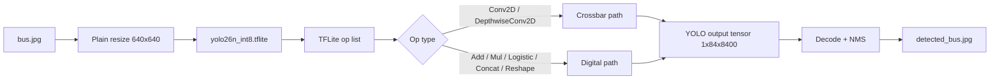

## Hardware Split

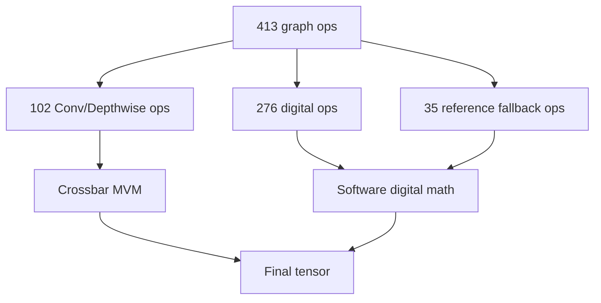

## Neuromorphic Hardware Architecture

The hardware path is split into a compile-time mapping flow and a runtime PE execution flow. The parser extracts convolution geometry from the model, the mapping file describes how K/C/R/S/Y/X are tiled, and the scheduler turns that mapping into PE program and compute commands.

### Model to Mapping Flow

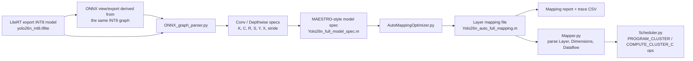

The ONNX path in this project is based on the LiteRT-exported INT8 model. In other words, the ONNX/parser flow is used to recover layer geometry and mapping metadata for the quantized CNN graph; the hardware execution still targets signed INT8 weights, unsigned INT8 activation patches, and INT32 accumulation on the crossbar path.

### Hardware Block Diagram

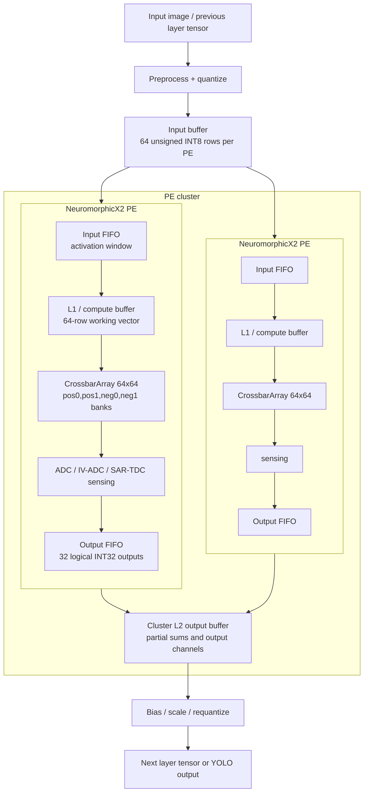

In the hardware view, L2 is the cluster-level output/feature buffer, while each PE has local input and L1/compute buffering around the crossbar. In the current Python simulator, the L1 working vector is represented by the PE FIFO/compute path, and the positive/negative 4-bit storage banks are held inside `CrossbarArray`.

### Mapping File on Crossbar

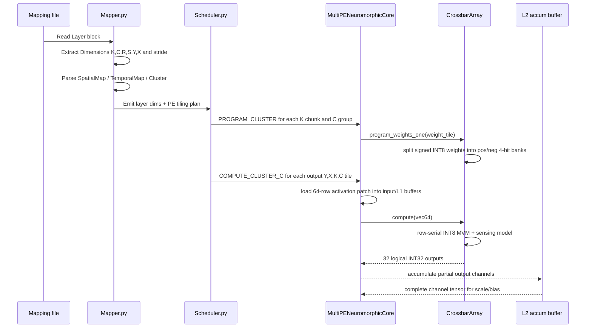

The mapping file controls the main hardware decisions:

| Mapping concept | Hardware meaning |
|---|---|
| `SpatialMap(... ) K` | Splits output channels across PE clusters or K chunks. |
| `Cluster(..., P)` | Groups PEs so several channel/input slices can work in parallel. |
| `SpatialMap(... ) C` after `Cluster` | Assigns input-channel groups to PEs inside a cluster. |
| `TemporalMap(... ) R/S/Y/X` | Defines the patch/window traversal order for repeated compute calls. |
| `C*R*S > 64` | Splits the input patch across multiple PE groups or vectorized waves. |

## Crossbar Layer Path

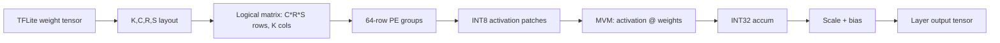

## One PE Data Path

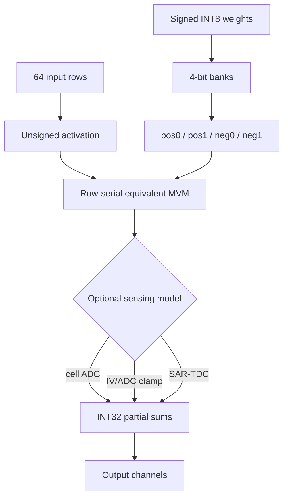

## Nonlinear Hardware Effects

`test_layer0_pe_effects.py` is the focused nonlinearity, reliability, and noise harness for the layer-0 CNN PE. It loads the layer-0 weights and activation patches, runs a clean `CrossbarArray` baseline, then reruns the same workload with one hardware effect enabled at a time. Each scenario is compared against the clean PE output with MAE, RMSE, max absolute delta, changed-output fraction, effective-weight changed fraction, ECC latency cycles, retention time, endurance failed-cell fraction, IV/ADC saturation counts, and SAR-TDC metadata. Results are written to `layer0_pe_effect_test_results/summary.csv` and `summary.json`.

The PE uses signed INT8 weights and unsigned INT8 activations. Each signed weight is decomposed into positive and negative magnitudes, then each magnitude is split into two 4-bit banks:

```text
w_pos = max(w, 0) = pos0 + 16 * pos1
w_neg = max(-w, 0) = neg0 + 16 * neg1
w = w_pos - w_neg
```

Reliability effects that change stored cell levels are applied during `program_weights()`. Readout noise, IV/ADC clamp, and SAR-TDC sensing effects are applied during `compute()`.

The current CNN hardware-effect surface includes:

```text
reliability: stuck cells, raw BER, ECC estimate, retention, relaxation, conductance spread, endurance
noise: thermal, shot, flicker / 1/f, RTN, readout RMS
sensing: cell ADC, IV/ADC saturation, SAR-TDC differential conversion
```

### Nonlinearity Stress Rerun

Rerun command: `python test_layer0_pe_effects.py` on 2026-07-03. The table reports the layer-0 PE measurement against the clean crossbar baseline as `MAE / max |delta| / changed outputs`.

| Nonlinearity model | Built for | Stress used | Measured in latest rerun |
|---|---|---|---|
| Clean PE execution | Proves the row-serial crossbar PE matches the INT32 digital reference before stressing it. | No injected hardware effect. | `0.000 / 0 / 0.0%`; clean PE matches digital reference. |
| Stuck-at LRS/HRS faults | Permanent ReRAM cell defects after programming. | `2%` stuck-LRS plus `2%` stuck-HRS cells. | `16960.061 / 54720 / 74.5%`; effective weights changed `8.8%`. |
| Raw BER, no ECC | Uncorrected bit errors in 4-bit stored cell levels. | `10000 ppm` raw BER, ECC off. | `7514.537 / 29298 / 90.3%`; effective weights changed `13.4%`. |
| Raw BER with ECC | Residual error after SEC-style correction and its latency cost. | `10000 ppm` raw BER, 38-bit codeword, 32-bit data, 1 encode and 1 decode cycle. | `1896.586 / 15048 / 40.2%`; ECC latency `19264` cycles. |
| Retention drift | Weight-stationary ReRAM drift during mapped YOLO layer residency. | State power-law drift at `125 C`, retention time `0.006144 s`. | `0.000 / 0 / 0.0%`; no changed outputs at this mapped residency. |
| Relaxation drift | Fast post-program settling before inference. | `7200 s` relaxation, `tau=2000 s`, amplitude `0.16 ln(R)`. | `3289.412 / 19608 / 50.0%`; effective weights changed `20.8%`. |
| State/conductance variation | Programming spread and device-to-device conductance variation. | Gaussian log-resistance sigma `0.12`. | `3249.668 / 10716 / 96.9%`; effective weights changed `35.2%`. |
| Endurance limit failure modes | End-of-life cells with stuck and multilevel-loss modes. | `100000` writes at a `100000` cycle limit; `2%` LRS, `2%` HRS, `12%` multilevel loss. | `21647.643 / 69312 / 99.8%`; failed cells `15.4%`. |
| Thermal and shot noise | Current noise under high-temperature, high-bandwidth read. | `400 K`, Fano `5`, bandwidth `5e10 Hz`. | `5722.821 / 31573 / 100.0%`. |
| Flicker / 1/f noise | Low-frequency read noise. | `50 kHz` bandwidth, `0.1 Hz` fmin, `A_LRS=2e-4`, `A_HRS=8e-4`. | `706.691 / 3570 / 99.7%`. |
| RTN noise | Random telegraph noise from state-dependent current jumps. | RTN amplitude fraction `0.08` LRS and `0.18` HRS. | `654.264 / 2686 / 99.7%`. |
| Readout noise | Fixed RMS sensing noise floor. | `4e-7 A rms` readout noise. | `21446.835 / 79831 / 100.0%`. |
| ADC clipping / quantization | IV/ADC nonlinear transfer and column saturation. | Hard clamp with ADC full scale `255` levels. | `1775.969 / 6896 / 50.0%`; `892` upper saturations across `16` columns. |
| SAR-TDC 8b | Differential branch sensing quantized by SAR-TDC. | `8b` SAR-FP output, gain shift `0`, effective coarse/fine bits `4/3`. | `226.828 / 1676 / 50.0%`. |

### Full 102-Layer Aggregate Audit

Rerun command: `python test_all_layers_nonlinearity_effects.py` on 2026-07-06. This audit covers all `102` crossbar-eligible Conv/Depthwise layers using the LiteRT reference activation tensors with the same INT8 bridge used by the crossbar executor. Results are written to `all_layer_nonlinearity_effect_test_results/summary.md`, `summary.json`, and `layer_summary.csv`.

| Effect | Enabled hardware model | Main measured error / stress |
|---|---|---|
| Reliability | 30-day retention drift, 0.02 log-normal state spread, 10 ppm raw BER with ECC | 30,210,165,440 programmed cell reads audited; 29,965,565,094 cell-level reads changed after the retention/state model; 1 raw BER flips after ECC; 808,391,600 effective INT8 weight read entries changed; mean absolute integer branch error 2.687606; max 2,286 |
| Noise | Thermal 4 k T / R, shot 2 q I * fano, flicker/1/f, RTN, readout RMS, 5 kHz bandwidth integration | Mean equivalent branch read-noise sigma 0.026175 conductance levels; max 0.029965 levels |
| IV / ADC | hard_clamp, 4 row groups, full-scale 2,250 product levels before digitization | 29,941,977 upper saturation events; 0 lower clips; 10,293,222 clamped tile-columns; 262,320 saturated tiles; max branch level 14,599 |
| TDC | 9-bit signed-payload SAR-FP TDC, gain_shift=0 | 68,276,800 output values converted; 614,491,200 wire bits; 0 extra SAR range clips after IV limiting; mean absolute integer readout error 23.864615; max 128 |

### Retention Assumptions

YOLO26 uses stationary weights, so the default retention strategy is `weight_stationary`. The layer-0 test estimates retention time from `Yolo26n_auto_layer0_mapping_report.csv` and the configured cycle time:

```text
retention_time_s = mapping_residency_cycles * LAYER0_MAPPING_CYCLE_TIME_S
```

By default `LAYER0_MAPPING_CYCLE_TIME_S=1e-9`, so layer-0 weight-stationary residency is currently about `0.006144 s`. That is intentionally much smaller than a fixed long-term storage value such as 180 days. For long-storage stress tests, override the residency explicitly:

```powershell
$env:LAYER0_WEIGHT_STATIONARY_RETENTION_S = "2592000"
```

### Endurance Assumptions

The current endurance scenario does not count every cell's write history over repeated simulator calls. Instead, it assumes the array has already experienced `endurance_write_cycles`. When that value reaches `endurance_cycles`, the model injects end-of-life failure modes across the programmed cell population:

```text
stuck at LRS
stuck at HRS
analog / multilevel accuracy loss
```

The summary reports how many programmed cells entered those failure modes. A full lifecycle model would add persistent per-bank write counters for `pos0`, `pos1`, `neg0`, and `neg1`, increment them on each program event, and make each cell fail when its own counter reaches the endurance limit.

## Fast vs Slow Hardware Mode

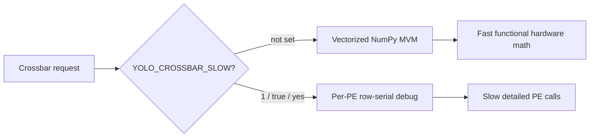

## Vectorized MVM Shape

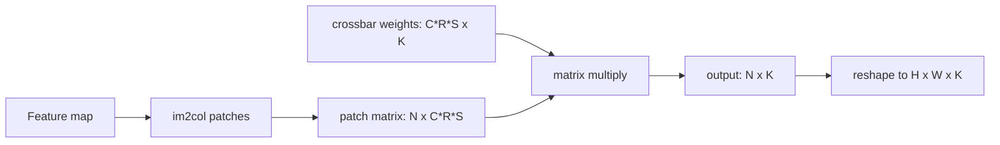

## Depthwise Fix

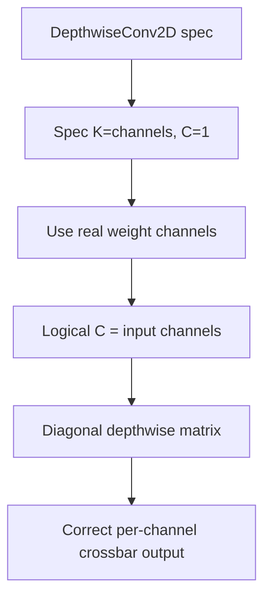

## PE Capacity Handling

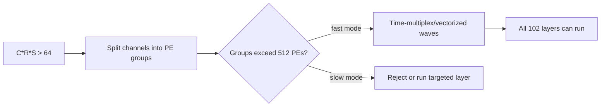

## Detection Output

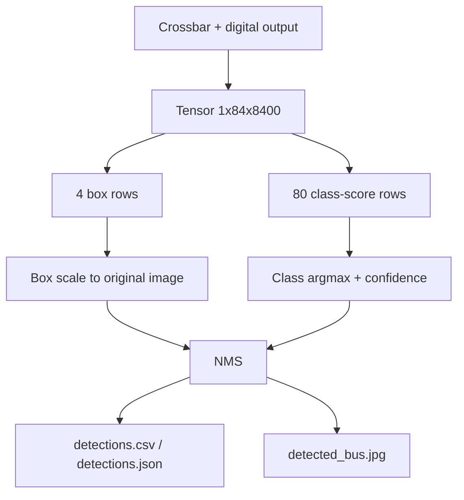

## Latest Result

```text
person 0.891  [671,395,809,879]
person 0.841  [48,394,235,905]
person 0.839  [224,399,346,860]
bus    0.834  [1,225,806,746]
person 0.666  [1,556,70,873]
```

## Key Files

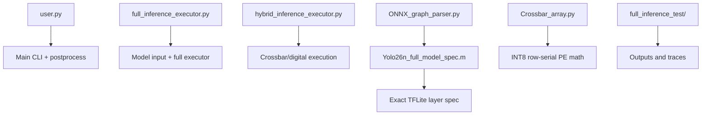

## Output Files

| File | Meaning |
|---|---|
| `full_inference_test/detected_bus.jpg` | Annotated image |
| `full_inference_test/detections.csv` | Compact detections |
| `full_inference_test/detections.json` | Full detections |
| `full_inference_test/execution_trace.csv` | Backend per op |
| `full_inference_test/hardware_summary.json` | Crossbar/digital counts |
| `full_inference_test/final_output_float.npy` | YOLO output tensor |

## Architecture Boundary

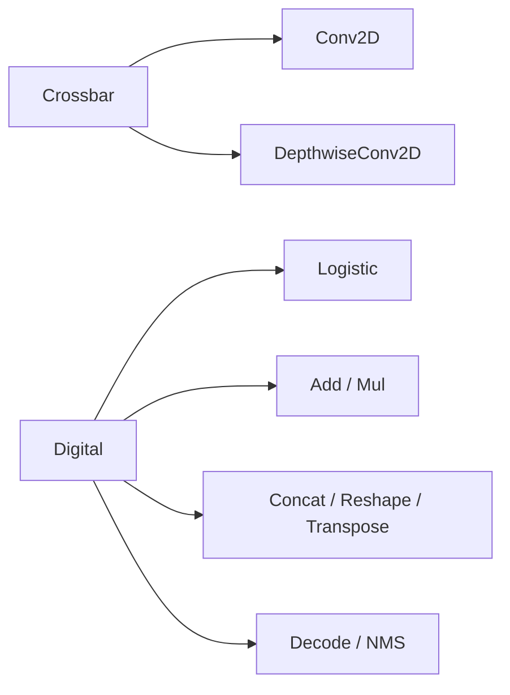

```text
Crossbar scope: MAC-heavy Conv/Depthwise layers.
Digital scope: graph glue, activations, tensor movement, YOLO decode.
```

